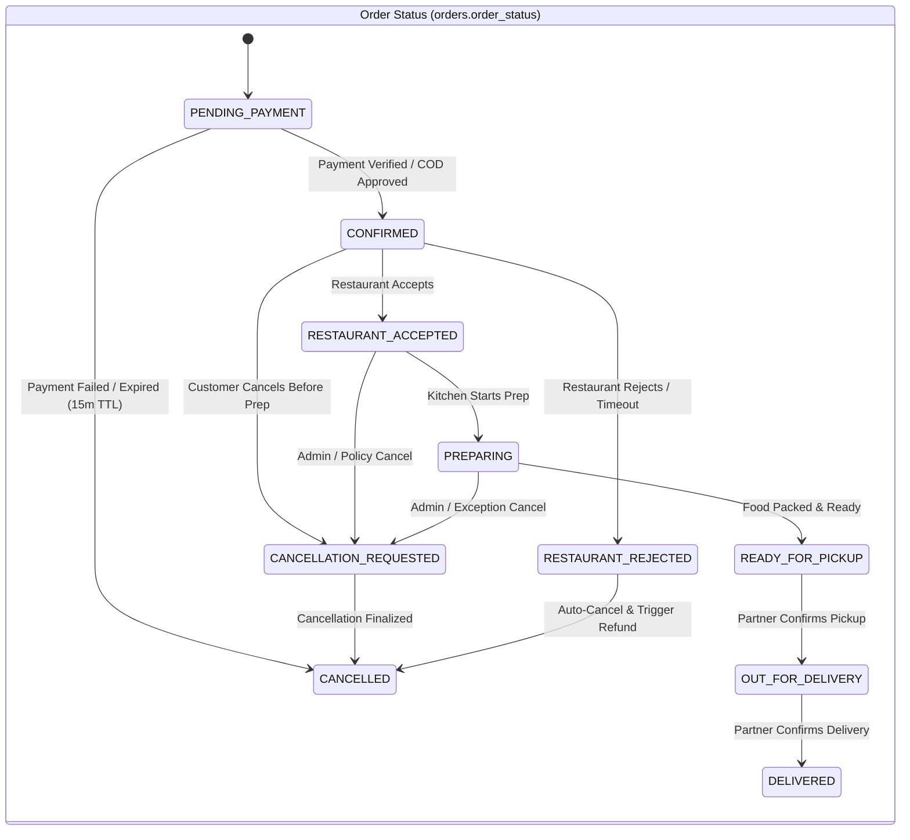
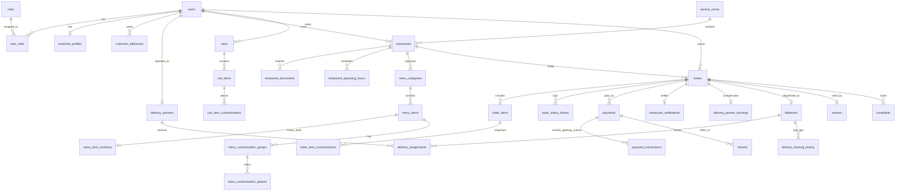

# Database Design — Goodly Food Delivery Platform

## 1. Foundational Design Principles (SRS Section 7)

1. **Authoritative System of Record**: PostgreSQL 16 with **PostGIS 3.4** (`postgis`, `pg_trgm`, `pgcrypto` extensions) is the sole permanent system of record. Redis and RabbitMQ never hold authoritative business state.
2. **Exact Monetary Representation**: All monetary columns are stored as `BIGINT` in **minor currency units** (e.g., cents for USD `$18.00` $\rightarrow$ `1800`; paise for INR `₹450.00` $\rightarrow$ `45000`) alongside an explicit ISO-4217 `currency CHAR(3)` column. Floating-point types (`FLOAT`, `REAL`) are strictly prohibited for financial figures.
3. **Time & Timezones**: Every timestamp uses `TIMESTAMPTZ` stored in UTC. Service zones and restaurants store an explicit IANA timezone identifier (e.g., `America/New_York` or `Asia/Kolkata`, `VARCHAR(64)`) to evaluate operating hours accurately across daylight saving and regional boundaries.
4. **Primary Keys**: All primary keys use `UUID` (generated as time-ordered **UUIDv7** in Go application code or `gen_random_uuid()` fallback) for B-Tree locality and zero enumeration leakage.
5. **Orthogonal State Machines (SRS Section 5.2)**: Rather than conflating order, payment, and delivery states into a single ambiguous column, the `orders` record maintains three orthogonal state columns (`order_status`, `payment_status`, `delivery_status`) plus an optimistic concurrency counter (`version INT NOT NULL DEFAULT 1`).

---

## 2. Orthogonal State Machines & Controlled Transitions

### Valid State Enums
- **`order_status_enum`**: `PENDING_PAYMENT`, `CONFIRMED`, `RESTAURANT_ACCEPTED`, `RESTAURANT_REJECTED`, `PREPARING`, `READY_FOR_PICKUP`, `OUT_FOR_DELIVERY`, `DELIVERED`, `CANCELLATION_REQUESTED`, `CANCELLED`
- **`payment_status_enum`**: `UNPAID`, `PENDING`, `AUTHORIZED`, `CAPTURED`, `FAILED`, `REFUND_PENDING`, `PARTIALLY_REFUNDED`, `REFUNDED`
- **`delivery_status_enum`**: `NOT_APPLICABLE`, `ASSIGNMENT_PENDING`, `PARTNER_OFFERED`, `PARTNER_ASSIGNED`, `ARRIVED_AT_RESTAURANT`, `PICKED_UP`, `OUT_FOR_DELIVERY`, `ARRIVED_AT_CUSTOMER`, `DELIVERED`, `UNASSIGNABLE`, `CANCELLED`

---

## 3. Entity-Relationship Diagram (Core Domains)

---

## 4. Complete Database Schema (Tables, Columns, Constraints & Indexes)

### 4.1 Identity, Authentication & RBAC Domain

#### 1. `users`
| Column | Type | Constraints | Description |
| :--- | :--- | :--- | :--- |
| `id` | `UUID` | `PRIMARY KEY` | Unique user identifier (UUIDv7) |
| `email` | `VARCHAR(255)` | `UNIQUE NOT NULL` | Normalized lowercase email |
| `phone` | `VARCHAR(20)` | `UNIQUE NOT NULL` | E.164 formatted phone number |
| `password_hash` | `TEXT` | `NOT NULL` | Argon2id password hash |
| `full_name` | `VARCHAR(150)` | `NOT NULL` | Display name |
| `avatar_url` | `TEXT` | `NULL` | Profile photo URL |
| `is_email_verified` | `BOOLEAN` | `NOT NULL DEFAULT FALSE` | Email verification state |
| `is_phone_verified` | `BOOLEAN` | `NOT NULL DEFAULT FALSE` | OTP verification state |
| `status` | `VARCHAR(32)` | `NOT NULL DEFAULT 'ACTIVE'` | `ACTIVE`, `SUSPENDED`, `DEACTIVATED` |
| `last_login_at` | `TIMESTAMPTZ` | `NULL` | Last successful login |
| `created_at` | `TIMESTAMPTZ` | `NOT NULL DEFAULT NOW()` | Record creation UTC |
| `updated_at` | `TIMESTAMPTZ` | `NOT NULL DEFAULT NOW()` | Last update UTC |

- **Indexes**: `idx_users_email` (`UNIQUE`), `idx_users_phone` (`UNIQUE`), `idx_users_status` (`status`).

#### 2. `roles`, `user_roles`, `admin_permissions`, `role_permissions`
> [!IMPORTANT]
> **Strict Role & Terminology Separation (Final Business Decisions §1)**:
> - **`PLATFORM_ADMIN`** (`SUPER_ADMIN`, `OPS_ADMIN`, `FINANCE_ADMIN`): Platform owner / app owner with full or domain-scoped platform governance.
> - **`CUSTOMER_CARE`**: Separate operational support role with restricted permissions (handling 5-minute order acceptance timeout alerts, customer complaints, and authorized delivery exception overrides).
> - **`OUTLET_OWNER`**: Restaurant/outlet owner who can own **multiple outlets (branches)** with consolidated cross-outlet visibility and invite branch managers/staff.
> - **`BRANCH_MANAGER` & `OUTLET_STAFF`**: Branch-scoped restaurant personnel whose access is strictly limited to their assigned `outlet_id`s and granular permission flags in `outlet_staff_assignments`.
> - **`DELIVERY_PARTNER`** and **`CUSTOMER`**.

- **`roles`**: `id UUID PK`, `code VARCHAR(50) UNIQUE NOT NULL` (`CUSTOMER`, `OUTLET_OWNER`, `BRANCH_MANAGER`, `OUTLET_STAFF`, `DELIVERY_PARTNER`, `CUSTOMER_CARE`, `PLATFORM_ADMIN`, `OPS_ADMIN`, `FINANCE_ADMIN`), `name VARCHAR(100) NOT NULL`, `description TEXT`.
- **`user_roles`**: `user_id UUID FK -> users(id) ON DELETE CASCADE`, `role_id UUID FK -> roles(id) ON DELETE RESTRICT`, `granted_by UUID FK -> users(id) NULL`, `granted_at TIMESTAMPTZ NOT NULL DEFAULT NOW()`. `PRIMARY KEY (user_id, role_id)`.
- **`admin_permissions`**: `id UUID PK`, `slug VARCHAR(100) UNIQUE NOT NULL` (e.g., `users:manage`, `restaurants:verify`, `partners:verify`, `orders:monitor`, `orders:intervene`, `orders:timeout_escalate`, `delivery:override_otp`, `refunds:approve`, `commissions:configure`, `promotions:manage`, `zones:manage`, `complaints:resolve`, `reports:view`, `audit_logs:view`, `settings:manage`), `description TEXT`.
- **`role_permissions`**: `role_id UUID FK -> roles(id) ON DELETE CASCADE`, `permission_id UUID FK -> admin_permissions(id) ON DELETE CASCADE`. `PRIMARY KEY (role_id, permission_id)`.

#### 3. `auth_sessions`
| Column | Type | Constraints | Description |
| :--- | :--- | :--- | :--- |
| `id` | `UUID` | `PRIMARY KEY` | Session ID (`jti`) |
| `user_id` | `UUID` | `NOT NULL REFERENCES users(id) ON DELETE CASCADE` | Authenticated user |
| `token_family_id` | `UUID` | `NOT NULL` | Rotation family ID for reuse detection |
| `refresh_token_hash` | `CHAR(64)` | `UNIQUE NOT NULL` | SHA-256 hash of refresh token |
| `user_agent` | `TEXT` | `NULL` | Browser user-agent |
| `ip_address` | `INET` | `NULL` | Client IP |
| `is_revoked` | `BOOLEAN` | `NOT NULL DEFAULT FALSE` | Explicit revocation flag |
| `expires_at` | `TIMESTAMPTZ` | `NOT NULL` | Expiration timestamp |
| `created_at` | `TIMESTAMPTZ` | `NOT NULL DEFAULT NOW()` | Issued timestamp |

- **Indexes**: `idx_auth_sessions_user_active` (`user_id, expires_at`) `WHERE is_revoked = FALSE`, `idx_auth_sessions_family` (`token_family_id`).

#### 4. `otp_verifications`
- `id UUID PK`, `user_id UUID NULL REFERENCES users(id) ON DELETE CASCADE`, `target VARCHAR(255) NOT NULL` (phone or email), `purpose VARCHAR(32) NOT NULL` (`REGISTER`, `LOGIN`, `PASSWORD_RESET`, `SENSITIVE_ACTION`, `DELIVERY_PIN`), `otp_hash CHAR(64) NOT NULL`, `attempts INT NOT NULL DEFAULT 0`, `max_attempts INT NOT NULL DEFAULT 5`, `expires_at TIMESTAMPTZ NOT NULL`, `consumed_at TIMESTAMPTZ NULL`, `created_at TIMESTAMPTZ NOT NULL DEFAULT NOW()`.
- **Indexes**: `idx_otp_target_purpose` (`target, purpose, expires_at`) `WHERE consumed_at IS NULL`.

---

### 4.2 Customer Domain

#### 5. `customer_profiles`
- `user_id UUID PRIMARY KEY REFERENCES users(id) ON DELETE CASCADE`, `dietary_preferences TEXT[] DEFAULT '{}'`, `default_address_id UUID NULL`, `total_orders_count INT NOT NULL DEFAULT 0`, `created_at TIMESTAMPTZ NOT NULL DEFAULT NOW()`, `updated_at TIMESTAMPTZ NOT NULL DEFAULT NOW()`.

#### 6. `customer_addresses`
| Column | Type | Constraints | Description |
| :--- | :--- | :--- | :--- |
| `id` | `UUID` | `PRIMARY KEY` | Address ID |
| `user_id` | `UUID` | `NOT NULL REFERENCES users(id) ON DELETE CASCADE` | Owner customer |
| `label` | `VARCHAR(50)` | `NOT NULL` | `Home`, `Work`, `Other` |
| `recipient_name` | `VARCHAR(150)` | `NOT NULL` | Receiver name |
| `recipient_phone` | `VARCHAR(20)` | `NOT NULL` | Contact phone for delivery |
| `address_line1` | `VARCHAR(255)` | `NOT NULL` | Street address / building |
| `address_line2` | `VARCHAR(255)` | `NULL` | Apartment / suite / floor |
| `landmark` | `VARCHAR(255)` | `NULL` | Nearby landmark |
| `city` | `VARCHAR(100)` | `NOT NULL` | City / borough (e.g., Brooklyn) |
| `state` | `VARCHAR(100)` | `NOT NULL` | State / province |
| `postal_code` | `VARCHAR(20)` | `NOT NULL` | ZIP / PIN code |
| `country_code` | `CHAR(2)` | `NOT NULL DEFAULT 'US'` | ISO country code |
| `delivery_instructions` | `TEXT` | `NULL` | Drop-off / buzzer notes |
| `location` | `GEOGRAPHY(Point, 4326)` | `NOT NULL` | PostGIS `ST_MakePoint(lng, lat)` |
| `is_default` | `BOOLEAN` | `NOT NULL DEFAULT FALSE` | Default selection flag |
| `is_archived` | `BOOLEAN` | `NOT NULL DEFAULT FALSE` | Soft-delete flag |
| `created_at` | `TIMESTAMPTZ` | `NOT NULL DEFAULT NOW()` | Created UTC |

- **Indexes**: `idx_customer_addresses_user` (`user_id`) `WHERE is_archived = FALSE`, `idx_customer_addresses_location_gist` `USING GIST (location)`.

#### 7. `customer_favorites`
- `user_id UUID REFERENCES users(id) ON DELETE CASCADE`, `restaurant_id UUID REFERENCES restaurants(id) ON DELETE CASCADE`, `created_at TIMESTAMPTZ NOT NULL DEFAULT NOW()`. `PRIMARY KEY (user_id, restaurant_id)`.

---

### 4.3 Service Areas & Restaurant / Multi-Outlet Domain

#### 8. `service_zones`
- `id UUID PK`, `name VARCHAR(120) UNIQUE NOT NULL` (e.g., `Brooklyn Core`, `Bengaluru Central`), `city VARCHAR(100) NOT NULL`, `timezone VARCHAR(64) NOT NULL`, `currency CHAR(3) NOT NULL`, `boundary GEOGRAPHY(Polygon, 4326) NOT NULL`, `is_active BOOLEAN NOT NULL DEFAULT TRUE`, `base_delivery_fee_minor BIGINT NOT NULL DEFAULT 0`, `min_cart_threshold_minor BIGINT NOT NULL DEFAULT 1500` (minimum cart subtotal before small-cart fee applies), `small_cart_fee_minor BIGINT NOT NULL DEFAULT 199` (cart fee applied **only** when subtotal `< min_cart_threshold_minor`), `created_at TIMESTAMPTZ NOT NULL DEFAULT NOW()`, `updated_at TIMESTAMPTZ NOT NULL DEFAULT NOW()`.
- **Indexes**: `idx_service_zones_boundary_gist` `USING GIST (boundary)`.

#### 9. `restaurants` (Outlets / Branches — Multi-Outlet Support under a Single `OUTLET_OWNER`)
| Column | Type | Constraints | Description |
| :--- | :--- | :--- | :--- |
| `id` | `UUID` | `PRIMARY KEY` | Outlet / Restaurant ID |
| `owner_user_id` | `UUID` | `NOT NULL REFERENCES users(id) ON DELETE RESTRICT` | Outlet Owner account (`OUTLET_OWNER`; may own multiple outlets/branches) |
| `brand_name` | `VARCHAR(160)` | `NULL` | Parent brand grouping name (e.g., `Sunday Table Group`) |
| `branch_name` | `VARCHAR(160)` | `NULL` | Specific branch label (e.g., `Carroll Gardens Flagship`, `Williamsburg Kitchen`) |
| `service_zone_id` | `UUID` | `NOT NULL REFERENCES service_zones(id) ON DELETE RESTRICT` | Operational zone |
| `slug` | `VARCHAR(160)` | `UNIQUE NOT NULL` | URL slug (e.g., `sunday-table`) |
| `name` | `VARCHAR(160)` | `NOT NULL` | Display name (`Sunday Table`) |
| `tagline` | `VARCHAR(255)` | `NULL` | Editorial tagline |
| `description` | `TEXT` | `NULL` | About copy |
| `cuisines` | `TEXT[]` | `NOT NULL DEFAULT '{}'` | e.g., `['Italian', 'Pasta', 'Comfort food']` |
| `established_year` | `SMALLINT` | `NULL` | e.g., `2018` |
| `phone` | `VARCHAR(20)` | `NOT NULL` | Kitchen contact phone |
| `email` | `VARCHAR(255)` | `NOT NULL` | Business email |
| `address_line1` | `VARCHAR(255)` | `NOT NULL` | Physical street address |
| `city` | `VARCHAR(100)` | `NOT NULL` | City |
| `state` | `VARCHAR(100)` | `NOT NULL` | State |
| `postal_code` | `VARCHAR(20)` | `NOT NULL` | Postal code |
| `location` | `GEOGRAPHY(Point, 4326)` | `NOT NULL` | Exact pickup coordinates |
| `max_delivery_radius_meters` | `INT` | `NOT NULL DEFAULT 7000` | Max delivery radius (`CHECK > 0`) |
| `hero_image_url` | `TEXT` | `NULL` | Banner image |
| `logo_image_url` | `TEXT` | `NULL` | Square logo |
| `verification_status` | `VARCHAR(32)` | `NOT NULL DEFAULT 'PENDING_REVIEW'` | `PENDING_REVIEW`, `APPROVED`, `REJECTED`, `SUSPENDED` |
| `is_active` | `BOOLEAN` | `NOT NULL DEFAULT TRUE` | Platform-level enable flag |
| `is_accepting_orders` | `BOOLEAN` | `NOT NULL DEFAULT FALSE` | Live kitchen online/offline pause/resume toggle |
| `pause_reason` | `VARCHAR(120)` | `NULL` | Optional reason when temporarily paused |
| `paused_until` | `TIMESTAMPTZ` | `NULL` | Auto-resume timestamp for temporary pause |
| `max_concurrent_orders` | `INT` | `NULL CHECK (max_concurrent_orders IS NULL OR max_concurrent_orders > 0)` | Optional/toggleable max simultaneous active orders configured by Outlet Owner |
| `active_orders_count` | `INT` | `NOT NULL DEFAULT 0 CHECK (active_orders_count >= 0)` | Live counter of active orders (`CONFIRMED` through `READY_FOR_PICKUP`) |
| `avg_prep_time_minutes` | `SMALLINT` | `NOT NULL DEFAULT 20` | Estimated kitchen prep time |
| `min_order_amount_minor` | `BIGINT` | `NOT NULL DEFAULT 0` | Restaurant-specific minimum subtotal if any |
| `packaging_fee_minor` | `BIGINT` | `NOT NULL DEFAULT 0` | Default packaging fee |
| `commission_rate_bps` | `INT` | `NULL` | Custom override in basis points (Platform default is `2000` = `20.00%`) |
| `commission_calculation_basis` | `VARCHAR(40)` | `NULL` | Optional override (`GROSS_FOOD_SUBTOTAL`, `NET_AFTER_OUTLET_DISCOUNT`, `SUBTOTAL_PLUS_PACKAGING`) |
| `rating_average` | `NUMERIC(3,2)` | `NOT NULL DEFAULT 0.00` | Cached aggregate rating (`4.90`) |
| `rating_count` | `INT` | `NOT NULL DEFAULT 0` | Total verified reviews (`1240`) |
| `search_vector` | `TSVECTOR` | `GENERATED ALWAYS AS (...) STORED` | Full-text search vector |
| `created_at` | `TIMESTAMPTZ` | `NOT NULL DEFAULT NOW()` | Created UTC |
| `updated_at` | `TIMESTAMPTZ` | `NOT NULL DEFAULT NOW()` | Updated UTC |

- **Indexes**:
  - `idx_restaurants_owner` (`owner_user_id`)
  - `idx_restaurants_location_gist` `USING GIST (location)`
  - `idx_restaurants_discovery` (`service_zone_id, verification_status, is_active, is_accepting_orders`)
  - `idx_restaurants_cuisines_gin` `USING GIN (cuisines)`
  - `idx_restaurants_search_gin` `USING GIN (search_vector)`
  - `idx_restaurants_name_trgm` `USING GIN (name gin_trgm_ops)`

#### 9b. `outlet_staff_assignments` (Granular Branch-Scoped Access for Branch Managers & Staff)
- `id UUID PK`, `outlet_id UUID NOT NULL REFERENCES restaurants(id) ON DELETE CASCADE`, `user_id UUID NOT NULL REFERENCES users(id) ON DELETE CASCADE`, `invited_by_owner_id UUID NOT NULL REFERENCES users(id)`, `role_code VARCHAR(32) NOT NULL` (`BRANCH_MANAGER`, `OUTLET_STAFF`), `permissions TEXT[] NOT NULL DEFAULT '{}'` (granular permission slugs: `outlet:orders:manage`, `outlet:menu:edit`, `outlet:inventory:toggle`, `outlet:hours:manage`, `outlet:capacity:configure`, `outlet:reports:view`), `status VARCHAR(24) NOT NULL DEFAULT 'ACTIVE'` (`INVITED`, `ACTIVE`, `REVOKED`), `created_at TIMESTAMPTZ NOT NULL DEFAULT NOW()`, `updated_at TIMESTAMPTZ NOT NULL DEFAULT NOW()`.
- **Constraints & Indexes**: `UNIQUE (outlet_id, user_id)`, `idx_outlet_staff_user` (`user_id, status`).

#### 10. `restaurant_documents`
- `id UUID PK`, `restaurant_id UUID NOT NULL REFERENCES restaurants(id) ON DELETE CASCADE`, `document_type VARCHAR(50) NOT NULL` (`BUSINESS_LICENSE`, `FOOD_SAFETY_CERT`, `TAX_ID`, `BANK_PROOF`), `document_number VARCHAR(100) NOT NULL`, `file_key TEXT NOT NULL` (S3 object key), `status VARCHAR(32) NOT NULL DEFAULT 'PENDING'` (`PENDING`, `VERIFIED`, `REJECTED`), `reviewed_by UUID NULL REFERENCES users(id)`, `review_notes TEXT NULL`, `reviewed_at TIMESTAMPTZ NULL`, `created_at TIMESTAMPTZ NOT NULL DEFAULT NOW()`.

#### 11. `restaurant_operating_hours` & 11b. `outlet_holiday_closures`
- **`restaurant_operating_hours`**: `id UUID PK`, `restaurant_id UUID NOT NULL REFERENCES restaurants(id) ON DELETE CASCADE`, `day_of_week SMALLINT NOT NULL CHECK (day_of_week BETWEEN 0 AND 6)` (`0=Sunday`), `slot_number SMALLINT NOT NULL DEFAULT 1`, `open_time TIME NOT NULL`, `close_time TIME NOT NULL`, `is_closed BOOLEAN NOT NULL DEFAULT FALSE`. `UNIQUE (restaurant_id, day_of_week, slot_number)`.
- **`outlet_holiday_closures`**: `id UUID PK`, `outlet_id UUID NOT NULL REFERENCES restaurants(id) ON DELETE CASCADE`, `closure_date DATE NOT NULL`, `open_time TIME NULL`, `close_time TIME NULL`, `is_full_day_closed BOOLEAN NOT NULL DEFAULT TRUE`, `reason VARCHAR(160) NULL`, `created_at TIMESTAMPTZ NOT NULL DEFAULT NOW()`. `UNIQUE (outlet_id, closure_date)`.

---

### 4.4 Menu, Flexible Scheduling, Customizations & Inventory Domain

#### 12. `menu_categories`
- `id UUID PK`, `restaurant_id UUID NOT NULL REFERENCES restaurants(id) ON DELETE CASCADE`, `name VARCHAR(120) NOT NULL` (e.g., `Most loved`, `From the kitchen`), `subtitle VARCHAR(255) NULL` (e.g., `The ones regulars come back for`), `display_order INT NOT NULL DEFAULT 0`, `is_active BOOLEAN NOT NULL DEFAULT TRUE`, `created_at TIMESTAMPTZ NOT NULL DEFAULT NOW()`, `updated_at TIMESTAMPTZ NOT NULL DEFAULT NOW()`.
- **Indexes**: `idx_menu_categories_rest_order` (`restaurant_id, display_order`).

#### 13. `menu_items`
| Column | Type | Constraints | Description |
| :--- | :--- | :--- | :--- |
| `id` | `UUID` | `PRIMARY KEY` | Dish ID |
| `restaurant_id` | `UUID` | `NOT NULL REFERENCES restaurants(id) ON DELETE CASCADE` | Owning outlet |
| `category_id` | `UUID` | `NOT NULL REFERENCES menu_categories(id) ON DELETE CASCADE` | Menu section |
| `name` | `VARCHAR(160)` | `NOT NULL` | Dish title (`Sunday rigatoni`) |
| `description` | `TEXT` | `NULL` | Ingredients/prep description |
| `badge_label` | `VARCHAR(60)` | `NULL` | e.g., `A HOUSE FAVORITE`, `VEGETARIAN`, `FRESH & BRIGHT` |
| `dietary_tags` | `TEXT[]` | `NOT NULL DEFAULT '{}'` | `['VEG', 'VEGAN', 'GLUTEN_FREE', 'SPICY']` |
| `base_price_minor` | `BIGINT` | `NOT NULL CHECK (base_price_minor >= 0)` | Price in minor units (`1800` = `$18.00`) |
| `currency` | `CHAR(3)` | `NOT NULL DEFAULT 'USD'` | Currency code |
| `image_url` | `TEXT` | `NULL` | Dish photo |
| `is_available` | `BOOLEAN` | `NOT NULL DEFAULT TRUE` | Live availability toggle (`FR-073`) |
| `is_active` | `BOOLEAN` | `NOT NULL DEFAULT TRUE` | Soft-deactivation flag (`FR-072`) |
| `prep_time_minutes` | `SMALLINT` | `NULL` | Item-specific prep time override |
| `rating_average` | `NUMERIC(3,2)` | `NOT NULL DEFAULT 0.00` | Aggregate dish-level rating (Final Business Decisions §6) |
| `rating_count` | `INT` | `NOT NULL DEFAULT 0` | Total verified dish-level ratings |
| `display_order` | `INT` | `NOT NULL DEFAULT 0` | Ordering within category |
| `version` | `INT` | `NOT NULL DEFAULT 1` | Incremented on price/option edit |
| `created_at` | `TIMESTAMPTZ` | `NOT NULL DEFAULT NOW()` | Created UTC |
| `updated_at` | `TIMESTAMPTZ` | `NOT NULL DEFAULT NOW()` | Updated UTC |

- **Indexes**: `idx_menu_items_rest_cat` (`restaurant_id, category_id, display_order`) `WHERE is_active = TRUE`, `idx_menu_items_name_trgm` `USING GIN (name gin_trgm_ops)`.

#### 13b. `menu_schedules` (Flexible Time-of-Day & Day-of-Week Menu Availability)
- `id UUID PK`, `outlet_id UUID NOT NULL REFERENCES restaurants(id) ON DELETE CASCADE`, `category_id UUID NULL REFERENCES menu_categories(id) ON DELETE CASCADE`, `menu_item_id UUID NULL REFERENCES menu_items(id) ON DELETE CASCADE`, `schedule_name VARCHAR(80) NOT NULL` (e.g., `Breakfast Only`, `Weekend Dinner Special`), `days_of_week SMALLINT[] NOT NULL DEFAULT '{0,1,2,3,4,5,6}'`, `start_time TIME NOT NULL`, `end_time TIME NOT NULL`, `is_active BOOLEAN NOT NULL DEFAULT TRUE`, `CHECK (category_id IS NOT NULL OR menu_item_id IS NOT NULL)`.

#### 14. `menu_item_inventory`
- `menu_item_id UUID PRIMARY KEY REFERENCES menu_items(id) ON DELETE CASCADE`, `track_inventory BOOLEAN NOT NULL DEFAULT FALSE` (supports both simple available/unavailable toggle when `FALSE` and quantity-based inventory when `TRUE`), `available_quantity INT NOT NULL DEFAULT 0 CHECK (available_quantity >= 0)`, `reserved_quantity INT NOT NULL DEFAULT 0 CHECK (reserved_quantity >= 0)`, `daily_reset_quantity INT NULL`, `updated_at TIMESTAMPTZ NOT NULL DEFAULT NOW()`.

#### 15. `menu_customization_groups` & 16. `menu_customization_options`
- **`menu_customization_groups`**: `id UUID PK`, `menu_item_id UUID NOT NULL REFERENCES menu_items(id) ON DELETE CASCADE`, `name VARCHAR(120) NOT NULL` (e.g., `Choose your pasta`, `Add-ons`), `min_selections SMALLINT NOT NULL DEFAULT 0`, `max_selections SMALLINT NOT NULL DEFAULT 1 CHECK (max_selections >= min_selections)`, `is_required BOOLEAN NOT NULL DEFAULT FALSE`, `display_order INT NOT NULL DEFAULT 0`.
- **`menu_customization_options`**: `id UUID PK`, `group_id UUID NOT NULL REFERENCES menu_customization_groups(id) ON DELETE CASCADE`, `name VARCHAR(120) NOT NULL` (e.g., `Extra Burrata`), `price_delta_minor BIGINT NOT NULL DEFAULT 0 CHECK (price_delta_minor >= 0)`, `is_default BOOLEAN NOT NULL DEFAULT FALSE`, `is_available BOOLEAN NOT NULL DEFAULT TRUE`, `display_order INT NOT NULL DEFAULT 0`.

---

### 4.5 Cart Domain

#### 17. `carts`, 18. `cart_items`, 19. `cart_item_customizations`
- **`carts`**: `id UUID PK`, `customer_id UUID UNIQUE NOT NULL REFERENCES users(id) ON DELETE CASCADE`, `restaurant_id UUID NULL REFERENCES restaurants(id) ON DELETE SET NULL`, `delivery_address_id UUID NULL REFERENCES customer_addresses(id) ON DELETE SET NULL`, `applied_coupon_id UUID NULL REFERENCES coupons(id) ON DELETE SET NULL`, `special_instructions TEXT NULL`, `version INT NOT NULL DEFAULT 1`, `updated_at TIMESTAMPTZ NOT NULL DEFAULT NOW()`.
- **`cart_items`**: `id UUID PK`, `cart_id UUID NOT NULL REFERENCES carts(id) ON DELETE CASCADE`, `menu_item_id UUID NOT NULL REFERENCES menu_items(id) ON DELETE CASCADE`, `quantity SMALLINT NOT NULL CHECK (quantity BETWEEN 1 AND 99)`, `options_fingerprint CHAR(64) NOT NULL` (SHA-256 of sorted selected option IDs so identical item+options merge quantities), `created_at TIMESTAMPTZ NOT NULL DEFAULT NOW()`, `updated_at TIMESTAMPTZ NOT NULL DEFAULT NOW()`. `UNIQUE (cart_id, menu_item_id, options_fingerprint)`.
- **`cart_item_customizations`**: `cart_item_id UUID NOT NULL REFERENCES cart_items(id) ON DELETE CASCADE`, `option_id UUID NOT NULL REFERENCES menu_customization_options(id) ON DELETE CASCADE`. `PRIMARY KEY (cart_item_id, option_id)`.

---

### 4.6 Promotions, Cart Fee, Delivery Pricing & Commissions Domain

#### 20. `promotional_campaigns` & 21. `coupons` & 22. `coupon_usages`
- **`promotional_campaigns`**: `id UUID PK`, `name VARCHAR(150) NOT NULL`, `description TEXT`, `banner_text VARCHAR(255) NULL`, `funded_by VARCHAR(32) NOT NULL DEFAULT 'PLATFORM'` (`PLATFORM`, `RESTAURANT`, `SHARED`), `restaurant_share_bps INT NOT NULL DEFAULT 0`, `budget_limit_minor BIGINT NULL`, `budget_spent_minor BIGINT NOT NULL DEFAULT 0`, `starts_at TIMESTAMPTZ NOT NULL`, `ends_at TIMESTAMPTZ NOT NULL`, `is_active BOOLEAN NOT NULL DEFAULT TRUE`, `created_by UUID REFERENCES users(id)`.
- **`coupons`**: `id UUID PK`, `campaign_id UUID NOT NULL REFERENCES promotional_campaigns(id) ON DELETE CASCADE`, `restaurant_id UUID NULL REFERENCES restaurants(id) ON DELETE CASCADE` (`NULL` = platform-wide), `code VARCHAR(40) UNIQUE NOT NULL`, `discount_type VARCHAR(24) NOT NULL` (`PERCENTAGE`, `FLAT_AMOUNT`, `FREE_DELIVERY`), `discount_value BIGINT NOT NULL` (bps for percentage or minor units for flat), `max_discount_minor BIGINT NULL`, `min_order_subtotal_minor BIGINT NOT NULL DEFAULT 0`, `first_order_only BOOLEAN NOT NULL DEFAULT FALSE`, `max_total_uses INT NULL`, `current_uses INT NOT NULL DEFAULT 0`, `max_uses_per_user INT NOT NULL DEFAULT 1`, `starts_at TIMESTAMPTZ NOT NULL`, `ends_at TIMESTAMPTZ NOT NULL`, `is_active BOOLEAN NOT NULL DEFAULT TRUE`.
- **`coupon_usages`**: `id UUID PK`, `coupon_id UUID NOT NULL REFERENCES coupons(id) ON DELETE RESTRICT`, `user_id UUID NOT NULL REFERENCES users(id) ON DELETE RESTRICT`, `order_id UUID UNIQUE NOT NULL REFERENCES orders(id) ON DELETE CASCADE`, `discount_applied_minor BIGINT NOT NULL`, `status VARCHAR(24) NOT NULL DEFAULT 'RESERVED'` (`RESERVED`, `REDEEMED`, `RELEASED`), `created_at TIMESTAMPTZ NOT NULL DEFAULT NOW()`.
  - **Index**: `idx_coupon_usages_user_coupon` (`coupon_id, user_id`) `WHERE status IN ('RESERVED', 'REDEEMED')`.

#### 23. `delivery_charge_rules` & 24. `commission_configs`
- **`delivery_charge_rules` (Zone-Specific & Systemwide Defaults — Final Business Decisions §3)**:
  - `id UUID PK`, `service_zone_id UUID NULL REFERENCES service_zones(id)` (`NULL` = systemwide default rule), `min_cart_threshold_minor BIGINT NOT NULL DEFAULT 1500` (minimum cart subtotal threshold configured by Platform Admin), `small_cart_fee_minor BIGINT NOT NULL DEFAULT 199` (cart fee applied **only** when order subtotal falls below `min_cart_threshold_minor`), `base_fee_minor BIGINT NOT NULL`, `base_distance_meters INT NOT NULL DEFAULT 2000`, `per_km_fee_minor BIGINT NOT NULL DEFAULT 100` (distance-based customer delivery charge), `free_delivery_threshold_minor BIGINT NULL`, `surge_multiplier_bps INT NOT NULL DEFAULT 10000` (`10000` = 1.0x), `partner_base_payout_minor BIGINT NOT NULL` (delivery partner base pay), `partner_per_km_payout_minor BIGINT NOT NULL` (delivery partner distance-based per-unit payment), `partner_daily_payout_fee_config JSONB NULL` (configurable daily payout fee rule, pending owner approval of exact formula), `is_active BOOLEAN NOT NULL DEFAULT TRUE`, `updated_by UUID REFERENCES users(id)`, `updated_at TIMESTAMPTZ NOT NULL DEFAULT NOW()`.
- **`commission_configs` (20% Initial Commission & Configurable Basis — Final Business Decisions §8)**:
  - `id UUID PK`, `service_zone_id UUID NULL REFERENCES service_zones(id)` (`NULL` = systemwide default), `default_commission_bps INT NOT NULL DEFAULT 2000` (**20.00%** initial restaurant commission), `calculation_basis VARCHAR(40) NOT NULL DEFAULT 'GROSS_FOOD_SUBTOTAL'` (`GROSS_FOOD_SUBTOTAL`, `NET_AFTER_OUTLET_DISCOUNT`, `SUBTOTAL_PLUS_PACKAGING`), `tax_rate_bps INT NOT NULL DEFAULT 888`, `platform_fee_minor BIGINT NOT NULL DEFAULT 99`, `effective_from TIMESTAMPTZ NOT NULL DEFAULT NOW()`, `created_by UUID REFERENCES users(id)`.

---

### 4.7 Order Management & Acceptance Timeout Escalation Domain

#### 25. `orders`
| Column | Type | Constraints | Description |
| :--- | :--- | :--- | :--- |
| `id` | `UUID` | `PRIMARY KEY` | Order UUID |
| `order_number` | `VARCHAR(24)` | `UNIQUE NOT NULL` | Human-readable ID (`GD-20261110-8F4A`) |
| `customer_id` | `UUID` | `NOT NULL REFERENCES users(id) ON DELETE RESTRICT` | Placing customer |
| `restaurant_id` | `UUID` | `NOT NULL REFERENCES restaurants(id) ON DELETE RESTRICT` | Target outlet/branch |
| `service_zone_id` | `UUID` | `NOT NULL REFERENCES service_zones(id) ON DELETE RESTRICT` | Service zone |
| `idempotency_key` | `VARCHAR(128)` | `NOT NULL` | Client idempotency token (`FR-027`, `NFR-011`) |
| `order_status` | `VARCHAR(32)` | `NOT NULL DEFAULT 'PENDING_PAYMENT'` | Orthogonal operational status |
| `payment_status` | `VARCHAR(32)` | `NOT NULL DEFAULT 'UNPAID'` | Orthogonal financial status |
| `delivery_status` | `VARCHAR(32)` | `NOT NULL DEFAULT 'ASSIGNMENT_PENDING'` | Orthogonal logistics status |
| `payment_method` | `VARCHAR(32)` | `NOT NULL` | `ONLINE`, `COD` |
| `currency` | `CHAR(3)` | `NOT NULL` | Currency code (`USD` / `INR`) |
| `item_subtotal_minor` | `BIGINT` | `NOT NULL CHECK (item_subtotal_minor >= 0)` | Sum of items + add-ons |
| `small_cart_fee_minor` | `BIGINT` | `NOT NULL DEFAULT 0` | Applied only when `item_subtotal_minor < min_cart_threshold_minor` |
| `min_cart_threshold_snapshot_minor` | `BIGINT` | `NOT NULL DEFAULT 0` | Immutable snapshot of cart threshold at checkout |
| `packaging_fee_minor` | `BIGINT` | `NOT NULL DEFAULT 0` | Outlet packaging fee |
| `delivery_fee_minor` | `BIGINT` | `NOT NULL DEFAULT 0` | Distance-based customer delivery fee |
| `platform_fee_minor` | `BIGINT` | `NOT NULL DEFAULT 0` | Platform service fee |
| `discount_amount_minor` | `BIGINT` | `NOT NULL DEFAULT 0` | Applied coupon discount |
| `tax_amount_minor` | `BIGINT` | `NOT NULL DEFAULT 0` | Calculated tax |
| `tip_amount_minor` | `BIGINT` | `NOT NULL DEFAULT 0` | Optional delivery partner tip |
| `total_payable_minor` | `BIGINT` | `NOT NULL CHECK (total_payable_minor >= 0)` | Exact final amount charged (`FR-024`) |
| `commission_rate_bps_snapshot` | `INT` | `NOT NULL DEFAULT 2000` | Immutable commission rate snapshot (`2000` = 20%) |
| `commission_basis_snapshot` | `VARCHAR(40)` | `NOT NULL DEFAULT 'GROSS_FOOD_SUBTOTAL'` | Immutable commission calculation basis snapshot |
| `coupon_id` | `UUID` | `NULL REFERENCES coupons(id) ON DELETE SET NULL` | Applied coupon reference |
| `coupon_code_snapshot` | `VARCHAR(40)` | `NULL` | Snapshot of coupon code |
| `delivery_address_snapshot` | `JSONB` | `NOT NULL` | Immutable address + recipient details |
| `delivery_location` | `GEOGRAPHY(Point, 4326)` | `NOT NULL` | Immutable dropoff coordinates |
| `pickup_location` | `GEOGRAPHY(Point, 4326)` | `NOT NULL` | Immutable outlet coordinates |
| `road_distance_meters` | `INT` | `NOT NULL` | Computed route distance |
| `special_instructions` | `TEXT` | `NULL` | Kitchen / delivery notes |
| `estimated_prep_minutes` | `SMALLINT` | `NOT NULL` | Prep estimate at acceptance |
| `estimated_delivery_at` | `TIMESTAMPTZ` | `NULL` | Dynamic customer ETA |
| `confirmed_at` | `TIMESTAMPTZ` | `NULL` | Payment verified timestamp |
| `accept_deadline_at` | `TIMESTAMPTZ` | `NULL` | Initial acceptance deadline (`confirmed_at + 5 minutes` default) |
| `customer_care_alerted_at` | `TIMESTAMPTZ` | `NULL` | Timestamp when Customer Care was alerted after 5m timeout |
| `grace_deadline_at` | `TIMESTAMPTZ` | `NULL` | End of configurable post-alert grace period |
| `acceptance_escalation_state` | `VARCHAR(32)` | `NOT NULL DEFAULT 'NONE'` | `NONE`, `CUSTOMER_CARE_ALERTED`, `GRACE_PERIOD`, `PENALTY_APPLIED` |
| `accepted_at` | `TIMESTAMPTZ` | `NULL` | Outlet accepted timestamp |
| `prepared_at` | `TIMESTAMPTZ` | `NULL` | Marked ready for pickup timestamp |
| `picked_up_at` | `TIMESTAMPTZ` | `NULL` | Partner collected order timestamp |
| `delivered_at` | `TIMESTAMPTZ` | `NULL` | Completed delivery timestamp (requires OTP verification) |
| `cancelled_at` | `TIMESTAMPTZ` | `NULL` | Cancelled timestamp |
| `cancellation_reason` | `TEXT` | `NULL` | Reason code & notes |
| `cancelled_by_role` | `VARCHAR(32)` | `NULL` | `CUSTOMER`, `OUTLET_OWNER`, `CUSTOMER_CARE`, `PLATFORM_ADMIN`, `SYSTEM` |
| `rating_prompt_status` | `VARCHAR(24)` | `NOT NULL DEFAULT 'PENDING_DELIVERY'` | `PENDING_DELIVERY`, `ELIGIBLE_ON_APP_OPEN`, `PROMPT_DISMISSED`, `RATED` |
| `version` | `INT` | `NOT NULL DEFAULT 1` | Optimistic concurrency version |
| `created_at` | `TIMESTAMPTZ` | `NOT NULL DEFAULT NOW()` | Order created UTC |
| `updated_at` | `TIMESTAMPTZ` | `NOT NULL DEFAULT NOW()` | Last state change UTC |

- **Unique Constraints & Indexes**:
  - `uq_orders_customer_idempotency` `UNIQUE (customer_id, idempotency_key)`
  - `idx_orders_customer_created` (`customer_id, created_at DESC`)
  - `idx_orders_customer_rating_prompt` (`customer_id, rating_prompt_status`) `WHERE rating_prompt_status = 'ELIGIBLE_ON_APP_OPEN'`
  - `idx_orders_restaurant_active` (`restaurant_id, order_status, created_at DESC`)
  - `idx_orders_acceptance_timeout` (`accept_deadline_at, grace_deadline_at`) `WHERE order_status = 'CONFIRMED'`
  - `idx_orders_pending_payment_timeout` (`created_at`) `WHERE order_status = 'PENDING_PAYMENT'`
  - `idx_orders_admin_live` (`service_zone_id, order_status, delivery_status`)

#### 25b. `outlet_penalties` (Auditable Financial/Operational Non-Acceptance Penalty Ledger — Final Business Decisions §4)
- `id UUID PK`, `outlet_id UUID NOT NULL REFERENCES restaurants(id) ON DELETE RESTRICT`, `owner_user_id UUID NOT NULL REFERENCES users(id) ON DELETE RESTRICT`, `order_id UUID UNIQUE NOT NULL REFERENCES orders(id) ON DELETE RESTRICT`, `reason_code VARCHAR(64) NOT NULL DEFAULT 'ACCEPTANCE_TIMEOUT_AFTER_GRACE'`, `penalty_rule_snapshot JSONB NOT NULL` (captures the active Admin-configured penalty parameters at time of breach), `penalty_amount_minor BIGINT NOT NULL CHECK (penalty_amount_minor >= 0)`, `currency CHAR(3) NOT NULL`, `order_resolution_policy VARCHAR(40) NOT NULL` (`AUTO_CANCEL_AND_REFUND`, `CUSTOMER_CARE_REASSIGN`), `status VARCHAR(24) NOT NULL DEFAULT 'APPLIED'` (`APPLIED`, `DEDUCTED_FROM_SETTLEMENT`, `WAIVED`), `waived_by_admin_id UUID NULL REFERENCES users(id)`, `waiver_reason TEXT NULL`, `created_at TIMESTAMPTZ NOT NULL DEFAULT NOW()`.

#### 26. `order_items` & 27. `order_item_customizations`
- **`order_items`**: `id UUID PK`, `order_id UUID NOT NULL REFERENCES orders(id) ON DELETE CASCADE`, `menu_item_id UUID NOT NULL REFERENCES menu_items(id) ON DELETE RESTRICT`, `item_name_snapshot VARCHAR(160) NOT NULL`, `quantity SMALLINT NOT NULL CHECK (quantity > 0)`, `unit_base_price_minor BIGINT NOT NULL`, `unit_customizations_price_minor BIGINT NOT NULL DEFAULT 0`, `line_total_minor BIGINT NOT NULL`.
- **`order_item_customizations`**: `id UUID PK`, `order_item_id UUID NOT NULL REFERENCES order_items(id) ON DELETE CASCADE`, `option_id UUID NULL REFERENCES menu_customization_options(id) ON DELETE SET NULL`, `group_name_snapshot VARCHAR(120) NOT NULL`, `option_name_snapshot VARCHAR(120) NOT NULL`, `price_delta_minor BIGINT NOT NULL`.

#### 28. `order_status_history`
- `id UUID PK`, `order_id UUID NOT NULL REFERENCES orders(id) ON DELETE CASCADE`, `from_order_status VARCHAR(32) NULL`, `to_order_status VARCHAR(32) NOT NULL`, `from_payment_status VARCHAR(32) NULL`, `to_payment_status VARCHAR(32) NOT NULL`, `from_delivery_status VARCHAR(32) NULL`, `to_delivery_status VARCHAR(32) NOT NULL`, `actor_user_id UUID NULL REFERENCES users(id)`, `actor_role VARCHAR(32) NOT NULL`, `reason TEXT NULL`, `metadata JSONB NOT NULL DEFAULT '{}'`, `created_at TIMESTAMPTZ NOT NULL DEFAULT NOW()`.
- **Index**: `idx_order_status_history_order` (`order_id, created_at ASC`).

---

### 4.8 Payments, Refunds & Financial Settlements Domain

#### 29. `payments`
| Column | Type | Constraints | Description |
| :--- | :--- | :--- | :--- |
| `id` | `UUID` | `PRIMARY KEY` | Internal payment ID |
| `order_id` | `UUID` | `NOT NULL REFERENCES orders(id) ON DELETE RESTRICT` | Associated order |
| `customer_id` | `UUID` | `NOT NULL REFERENCES users(id) ON DELETE RESTRICT` | Paying customer |
| `provider` | `VARCHAR(32)` | `NOT NULL` | `RAZORPAY`, `CASHFREE`, `STRIPE`, `COD` |
| `provider_order_id` | `VARCHAR(128)` | `UNIQUE NULL` | Gateway order/intent ID |
| `provider_payment_id` | `VARCHAR(128)` | `UNIQUE NULL` | Gateway captured payment ID |
| `amount_minor` | `BIGINT` | `NOT NULL CHECK (amount_minor >= 0)` | Total amount in minor units |
| `currency` | `CHAR(3)` | `NOT NULL` | Currency code |
| `status` | `VARCHAR(32)` | `NOT NULL DEFAULT 'INITIATED'` | `INITIATED`, `AUTHORIZED`, `CAPTURED`, `FAILED`, `REFUNDED`, `PARTIALLY_REFUNDED` |
| `payment_instrument` | `VARCHAR(64)` | `NULL` | `CARD`, `UPI`, `NETBANKING`, `WALLET`, `CASH` |
| `failure_code` | `VARCHAR(64)` | `NULL` | Gateway error code |
| `failure_message` | `TEXT` | `NULL` | Gateway error description |
| `captured_at` | `TIMESTAMPTZ` | `NULL` | Capture confirmation UTC |
| `reconciled_at` | `TIMESTAMPTZ` | `NULL` | Verified by reconciliation job (`FR-048`) |
| `version` | `INT` | `NOT NULL DEFAULT 1` | Optimistic lock counter |
| `created_at` | `TIMESTAMPTZ` | `NOT NULL DEFAULT NOW()` | Created UTC |
| `updated_at` | `TIMESTAMPTZ` | `NOT NULL DEFAULT NOW()` | Updated UTC |

- **Indexes**:
  - `uq_payments_active_order` `UNIQUE (order_id)` `WHERE status IN ('INITIATED', 'AUTHORIZED', 'CAPTURED')`
  - `idx_payments_unreconciled` (`status, created_at`) `WHERE status IN ('INITIATED', 'AUTHORIZED')`

#### 30. `payment_transactions` (Immutable Gateway Webhook & Attempt Log)
- `id UUID PK`, `payment_id UUID NOT NULL REFERENCES payments(id) ON DELETE RESTRICT`, `provider VARCHAR(32) NOT NULL`, `provider_event_id VARCHAR(128) NOT NULL` (Webhook ID for deduplication `FR-044`), `event_type VARCHAR(64) NOT NULL` (`payment.authorized`, `payment.captured`, `payment.failed`, `refund.processed`), `amount_minor BIGINT NOT NULL`, `raw_payload JSONB NOT NULL`, `signature_verified BOOLEAN NOT NULL`, `created_at TIMESTAMPTZ NOT NULL DEFAULT NOW()`.
- **Unique Constraint**: `uq_payment_tx_provider_event` `UNIQUE (provider, provider_event_id)`.

#### 31. `refunds`
- `id UUID PK`, `payment_id UUID NOT NULL REFERENCES payments(id) ON DELETE RESTRICT`, `order_id UUID NOT NULL REFERENCES orders(id) ON DELETE RESTRICT`, `idempotency_key VARCHAR(128) UNIQUE NOT NULL`, `provider_refund_id VARCHAR(128) UNIQUE NULL`, `amount_minor BIGINT NOT NULL CHECK (amount_minor > 0)`, `refund_type VARCHAR(24) NOT NULL` (`FULL`, `PARTIAL`), `reason_code VARCHAR(64) NOT NULL`, `notes TEXT NULL`, `status VARCHAR(32) NOT NULL DEFAULT 'PENDING'` (`PENDING`, `PROCESSING`, `PROCESSED`, `FAILED`), `initiated_by_user_id UUID NULL REFERENCES users(id)`, `initiated_by_role VARCHAR(32) NOT NULL`, `processed_at TIMESTAMPTZ NULL`, `created_at TIMESTAMPTZ NOT NULL DEFAULT NOW()`, `updated_at TIMESTAMPTZ NOT NULL DEFAULT NOW()`.

#### 32. `restaurant_settlements` & 33. `delivery_partner_earnings` & 34. `financial_ledger_entries`
- **`restaurant_settlements` (Immutable Commission Rate & Basis Snapshots — Final Business Decisions §8)**:
  - `id UUID PK`, `order_id UUID UNIQUE NOT NULL REFERENCES orders(id)`, `restaurant_id UUID NOT NULL REFERENCES restaurants(id)`, `owner_user_id UUID NOT NULL REFERENCES users(id)`, `gross_food_amount_minor BIGINT NOT NULL`, `packaging_fee_minor BIGINT NOT NULL`, `restaurant_promo_discount_minor BIGINT NOT NULL DEFAULT 0`, `commission_calculation_basis_snapshot VARCHAR(40) NOT NULL` (`GROSS_FOOD_SUBTOTAL`, `NET_AFTER_OUTLET_DISCOUNT`, `SUBTOTAL_PLUS_PACKAGING`), `commissionable_base_amount_minor BIGINT NOT NULL`, `platform_commission_bps INT NOT NULL` (default `2000` = `20%`), `platform_commission_minor BIGINT NOT NULL`, `penalty_deduction_minor BIGINT NOT NULL DEFAULT 0`, `tax_withheld_minor BIGINT NOT NULL DEFAULT 0`, `net_payout_minor BIGINT NOT NULL`, `settlement_status VARCHAR(32) NOT NULL DEFAULT 'ACCRUED'` (`ACCRUED`, `PAYOUT_SCHEDULED`, `PAID`, `REVERSED`), `payout_batch_id VARCHAR(64) NULL`, `settled_at TIMESTAMPTZ NULL`, `created_at TIMESTAMPTZ NOT NULL DEFAULT NOW()`.
- **`delivery_partner_earnings` (Base Pay + Distance Per-Unit Snapshot — Final Business Decisions §3)**:
  - `id UUID PK`, `delivery_id UUID UNIQUE NOT NULL REFERENCES deliveries(id)`, `order_id UUID NOT NULL REFERENCES orders(id)`, `partner_id UUID NOT NULL REFERENCES delivery_partners(id)`, `base_payout_minor BIGINT NOT NULL`, `per_km_rate_snapshot_minor BIGINT NOT NULL`, `distance_meters_snapshot INT NOT NULL`, `distance_payout_minor BIGINT NOT NULL`, `surge_bonus_minor BIGINT NOT NULL DEFAULT 0`, `tip_amount_minor BIGINT NOT NULL DEFAULT 0`, `gross_earning_minor BIGINT NOT NULL`, `daily_payout_fee_minor BIGINT NOT NULL DEFAULT 0`, `net_earning_minor BIGINT NOT NULL`, `status VARCHAR(32) NOT NULL DEFAULT 'CREDITED'` (`CREDITED`, `PAID`, `ADJUSTED`), `created_at TIMESTAMPTZ NOT NULL DEFAULT NOW()`.
- **`financial_ledger_entries`** (Double-entry immutable audit ledger): `id UUID PK`, `order_id UUID NOT NULL REFERENCES orders(id)`, `reference_type VARCHAR(32) NOT NULL` (`PAYMENT_CAPTURE`, `REFUND`, `SETTLEMENT_ACCRUAL`, `OUTLET_PENALTY`, `PARTNER_EARNING`), `reference_id UUID NOT NULL`, `debit_account VARCHAR(64) NOT NULL`, `credit_account VARCHAR(64) NOT NULL`, `amount_minor BIGINT NOT NULL CHECK (amount_minor > 0)`, `currency CHAR(3) NOT NULL`, `created_at TIMESTAMPTZ NOT NULL DEFAULT NOW()`.

---

### 4.9 Delivery Partner, Broadcast Dispatch, OTP Proof of Delivery & Tracking Domain

#### 35. `delivery_partners` & 36. `delivery_partner_documents`
- **`delivery_partners`**: `id UUID PK`, `user_id UUID UNIQUE NOT NULL REFERENCES users(id) ON DELETE RESTRICT`, `service_zone_id UUID NOT NULL REFERENCES service_zones(id)`, `vehicle_type VARCHAR(32) NOT NULL` (`BICYCLE`, `SCOOTER`, `MOTORCYCLE`, `CAR`), `vehicle_make_model VARCHAR(100) NULL`, `license_plate VARCHAR(32) NULL`, `verification_status VARCHAR(32) NOT NULL DEFAULT 'PENDING_REVIEW'` (`PENDING_REVIEW`, `APPROVED`, `REJECTED`, `SUSPENDED`), `availability_status VARCHAR(32) NOT NULL DEFAULT 'OFFLINE'` (`OFFLINE`, `ONLINE_AVAILABLE`, `ON_DELIVERY`), `is_busy BOOLEAN NOT NULL DEFAULT FALSE`, `active_deliveries_count SMALLINT NOT NULL DEFAULT 0 CHECK (active_deliveries_count >= 0)`, `max_concurrent_deliveries SMALLINT NOT NULL DEFAULT 1`, `last_known_location GEOGRAPHY(Point, 4326) NULL`, `last_location_at TIMESTAMPTZ NULL`, `rating_average NUMERIC(3,2) NOT NULL DEFAULT 5.00`, `rating_count INT NOT NULL DEFAULT 0`, `total_deliveries_count INT NOT NULL DEFAULT 0`, `created_at TIMESTAMPTZ NOT NULL DEFAULT NOW()`, `updated_at TIMESTAMPTZ NOT NULL DEFAULT NOW()`.
  - **Indexes**: `idx_delivery_partners_zone_avail` (`service_zone_id, verification_status, availability_status, is_busy`), `idx_delivery_partners_location_gist` `USING GIST (last_known_location)`.
- **`delivery_partner_documents`**: `id UUID PK`, `partner_id UUID NOT NULL REFERENCES delivery_partners(id) ON DELETE CASCADE`, `document_type VARCHAR(50) NOT NULL` (`DRIVERS_LICENSE`, `VEHICLE_REGISTRATION`, `INSURANCE`, `IDENTITY_PROOF`), `file_key TEXT NOT NULL`, `status VARCHAR(32) NOT NULL DEFAULT 'PENDING'`, `reviewed_by UUID NULL REFERENCES users(id)`, `reviewed_at TIMESTAMPTZ NULL`, `created_at TIMESTAMPTZ NOT NULL DEFAULT NOW()`.

#### 37. `deliveries`, 38. `delivery_assignments` (Broadcast Model) & 38b. `delivery_otps` (OTP Proof of Delivery)
- **`deliveries`**: `id UUID PK`, `order_id UUID UNIQUE NOT NULL REFERENCES orders(id) ON DELETE RESTRICT`, `partner_id UUID NULL REFERENCES delivery_partners(id) ON DELETE RESTRICT`, `reassigned_from_partner_id UUID NULL REFERENCES delivery_partners(id)`, `reassignment_count SMALLINT NOT NULL DEFAULT 0`, `status VARCHAR(32) NOT NULL DEFAULT 'ASSIGNMENT_PENDING'` (`ASSIGNMENT_PENDING`, `PARTNER_OFFERED`, `PARTNER_ASSIGNED`, `ARRIVED_AT_RESTAURANT`, `PICKED_UP`, `OUT_FOR_DELIVERY`, `ARRIVED_AT_CUSTOMER`, `DELIVERED`, `UNASSIGNABLE`, `CANCELLED`), `pickup_location GEOGRAPHY(Point, 4326) NOT NULL`, `dropoff_location GEOGRAPHY(Point, 4326) NOT NULL`, `broadcast_wave_count SMALLINT NOT NULL DEFAULT 0`, `assigned_at TIMESTAMPTZ NULL`, `arrived_restaurant_at TIMESTAMPTZ NULL`, `picked_up_at TIMESTAMPTZ NULL`, `arrived_customer_at TIMESTAMPTZ NULL`, `delivered_at TIMESTAMPTZ NULL`, `version INT NOT NULL DEFAULT 1`, `created_at TIMESTAMPTZ NOT NULL DEFAULT NOW()`, `updated_at TIMESTAMPTZ NOT NULL DEFAULT NOW()`.
- **`delivery_assignments` (Simultaneous Broadcast Offers + Atomic First-Accept — Final Business Decisions §5)**:
  - `id UUID PK`, `delivery_id UUID NOT NULL REFERENCES deliveries(id) ON DELETE CASCADE`, `order_id UUID NOT NULL REFERENCES orders(id) ON DELETE CASCADE`, `partner_id UUID NOT NULL REFERENCES delivery_partners(id) ON DELETE CASCADE`, `broadcast_wave SMALLINT NOT NULL DEFAULT 1`, `status VARCHAR(32) NOT NULL DEFAULT 'OFFERED'` (`OFFERED`, `ACCEPTED`, `REJECTED`, `EXPIRED`, `SUPERSEDED`, `CANCELLED_REASSIGNED`), `distance_to_pickup_meters INT NOT NULL`, `estimated_payout_minor BIGINT NOT NULL`, `offered_at TIMESTAMPTZ NOT NULL DEFAULT NOW()`, `expires_at TIMESTAMPTZ NOT NULL`, `responded_at TIMESTAMPTZ NULL`, `rejection_reason VARCHAR(100) NULL`.
  - **Indexes & Constraints**:
    - `idx_delivery_assignments_partner_active` (`partner_id, status, expires_at`) `WHERE status = 'OFFERED'`
    - `idx_delivery_assignments_delivery_active` (`delivery_id, status`) `WHERE status = 'OFFERED'`
    - `uq_delivery_single_accepted` `UNIQUE (delivery_id)` `WHERE status = 'ACCEPTED'` (guarantees at the database level that at most one partner can hold an active `ACCEPTED` assignment for a delivery).
- **`delivery_otps` (Backend-Controlled, Single-Use, Rate-Limited OTP Proof of Delivery — Final Business Decisions §7)**:
  - Applies to **every order** (`ONLINE` and `COD`). Delivery status **cannot** transition to `DELIVERED` unless `delivery_otps.verified_at IS NOT NULL` or `exception_override_by_user_id IS NOT NULL`.
  - `order_id UUID PRIMARY KEY REFERENCES orders(id) ON DELETE CASCADE`, `delivery_id UUID UNIQUE NOT NULL REFERENCES deliveries(id) ON DELETE CASCADE`, `otp_hash CHAR(64) NOT NULL` (HMAC-SHA256 of the single-use OTP), `failed_attempts SMALLINT NOT NULL DEFAULT 0`, `max_attempts SMALLINT NOT NULL DEFAULT 5`, `rate_limited_until TIMESTAMPTZ NULL` (enforces cooldown after repeated wrong attempts), `expires_at TIMESTAMPTZ NOT NULL`, `verified_at TIMESTAMPTZ NULL`, `verified_by_partner_id UUID NULL REFERENCES delivery_partners(id)`, `exception_override_by_user_id UUID NULL REFERENCES users(id)` (requires `delivery:override_otp` permission held by authorized `CUSTOMER_CARE` / `PLATFORM_ADMIN`), `exception_override_reason TEXT NULL`, `created_at TIMESTAMPTZ NOT NULL DEFAULT NOW()`.

#### 39. `delivery_tracking_history` (Time-Partitioned Breadcrumb Table `FR-069`)
- `id BIGSERIAL`, `delivery_id UUID NOT NULL`, `order_id UUID NOT NULL`, `partner_id UUID NOT NULL`, `location GEOGRAPHY(Point, 4326) NOT NULL`, `speed_mps REAL NULL`, `bearing_degrees REAL NULL`, `accuracy_meters REAL NULL`, `recorded_at TIMESTAMPTZ NOT NULL DEFAULT NOW()`. `PRIMARY KEY (id, recorded_at)` `PARTITION BY RANGE (recorded_at)`.
- **Retention Policy**: Monthly partitions (`delivery_tracking_history_y2026m11`); partitions older than 90 days are archived to S3 Parquet and detached/dropped via scheduled maintenance job.

---

### 4.10 Three-Category Ratings, Complaints, Notifications, Audit Logs & Reliability Infrastructure

#### 40. `reviews` & 40b. `order_item_ratings` (Three Independent Rating Categories — Final Business Decisions §6)
- **`reviews` (Category 1: Restaurant Rating & Category 2: Delivery Partner Rating)**:
  - `id UUID PK`, `order_id UUID UNIQUE NOT NULL REFERENCES orders(id) ON DELETE CASCADE` (enforces zero duplicate review submissions per order), `customer_id UUID NOT NULL REFERENCES users(id)`, `restaurant_id UUID NOT NULL REFERENCES restaurants(id)`, `partner_id UUID NULL REFERENCES delivery_partners(id)`, `restaurant_rating SMALLINT NOT NULL CHECK (restaurant_rating BETWEEN 1 AND 5)`, `delivery_partner_rating SMALLINT NULL CHECK (delivery_partner_rating BETWEEN 1 AND 5)`, `restaurant_comment TEXT NULL`, `delivery_partner_comment TEXT NULL`, `restaurant_reply TEXT NULL`, `replied_at TIMESTAMPTZ NULL`, `edit_count SMALLINT NOT NULL DEFAULT 0`, `editable_until TIMESTAMPTZ NOT NULL` (configurable rating-edit window, e.g., 24 hours after submission), `is_visible BOOLEAN NOT NULL DEFAULT TRUE`, `created_at TIMESTAMPTZ NOT NULL DEFAULT NOW()`, `updated_at TIMESTAMPTZ NOT NULL DEFAULT NOW()`.
- **`order_item_ratings` (Category 3: Optional Individual Food / Menu Item Ratings)**:
  - `id UUID PK`, `review_id UUID NOT NULL REFERENCES reviews(id) ON DELETE CASCADE`, `order_id UUID NOT NULL REFERENCES orders(id) ON DELETE CASCADE`, `order_item_id UUID UNIQUE NOT NULL REFERENCES order_items(id) ON DELETE CASCADE`, `menu_item_id UUID NOT NULL REFERENCES menu_items(id) ON DELETE CASCADE`, `customer_id UUID NOT NULL REFERENCES users(id)`, `rating SMALLINT NOT NULL CHECK (rating BETWEEN 1 AND 5)`, `comment TEXT NULL`, `created_at TIMESTAMPTZ NOT NULL DEFAULT NOW()`, `updated_at TIMESTAMPTZ NOT NULL DEFAULT NOW()`.

#### 41. `complaints` & 42. `complaint_messages`
- **`complaints`**: `id UUID PK`, `ticket_number VARCHAR(24) UNIQUE NOT NULL`, `order_id UUID NOT NULL REFERENCES orders(id)`, `raised_by_user_id UUID NOT NULL REFERENCES users(id)`, `category VARCHAR(64) NOT NULL` (`MISSING_ITEM`, `WRONG_ORDER`, `QUALITY_ISSUE`, `LATE_DELIVERY`, `BILLING_ISSUE`, `ACCEPTANCE_TIMEOUT_ESCALATION`), `priority VARCHAR(24) NOT NULL DEFAULT 'MEDIUM'`, `status VARCHAR(32) NOT NULL DEFAULT 'OPEN'` (`OPEN`, `IN_REVIEW`, `RESOLVED`, `CLOSED`), `description TEXT NOT NULL`, `evidence_image_urls TEXT[] DEFAULT '{}'`, `assigned_care_or_admin_id UUID NULL REFERENCES users(id)`, `resolution_notes TEXT NULL`, `linked_refund_id UUID NULL REFERENCES refunds(id)`, `resolved_at TIMESTAMPTZ NULL`, `created_at TIMESTAMPTZ NOT NULL DEFAULT NOW()`, `updated_at TIMESTAMPTZ NOT NULL DEFAULT NOW()`.
- **`complaint_messages`**: `id UUID PK`, `complaint_id UUID NOT NULL REFERENCES complaints(id) ON DELETE CASCADE`, `sender_user_id UUID NOT NULL REFERENCES users(id)`, `sender_role VARCHAR(32) NOT NULL`, `message TEXT NOT NULL`, `created_at TIMESTAMPTZ NOT NULL DEFAULT NOW()`.

#### 43. `notifications`
- `id UUID PK`, `user_id UUID NOT NULL REFERENCES users(id) ON DELETE CASCADE`, `channel VARCHAR(24) NOT NULL` (`IN_APP`, `WEB_PUSH`, `SMS`, `EMAIL`), `event_type VARCHAR(64) NOT NULL`, `title VARCHAR(200) NOT NULL`, `body TEXT NOT NULL`, `action_url TEXT NULL`, `delivery_status VARCHAR(24) NOT NULL DEFAULT 'PENDING'` (`PENDING`, `SENT`, `DELIVERED`, `FAILED`), `is_read BOOLEAN NOT NULL DEFAULT FALSE`, `read_at TIMESTAMPTZ NULL`, `created_at TIMESTAMPTZ NOT NULL DEFAULT NOW()`.

#### 44. `admin_audit_logs` & 45. `platform_configs`
- **`admin_audit_logs` (`FR-102`)**: `id UUID PK`, `actor_user_id UUID NOT NULL REFERENCES users(id)`, `actor_role VARCHAR(50) NOT NULL` (`PLATFORM_ADMIN`, `OPS_ADMIN`, `FINANCE_ADMIN`, `CUSTOMER_CARE`, `OUTLET_OWNER`), `permission_used VARCHAR(100) NOT NULL`, `action VARCHAR(100) NOT NULL`, `target_entity_type VARCHAR(64) NOT NULL`, `target_entity_id VARCHAR(128) NOT NULL`, `before_state JSONB NULL`, `after_state JSONB NULL`, `reason TEXT NULL`, `ip_address INET NULL`, `correlation_id VARCHAR(64) NULL`, `created_at TIMESTAMPTZ NOT NULL DEFAULT NOW()`.
- **`platform_configs`**: `key VARCHAR(100) PRIMARY KEY`, `value JSONB NOT NULL`, `description TEXT NOT NULL`, `updated_by UUID REFERENCES users(id)`, `updated_at TIMESTAMPTZ NOT NULL DEFAULT NOW()`.

#### 46. Reliability Tables: `outbox_events`, `processed_messages`, `idempotency_records`
- **`outbox_events`**: `id UUID PK`, `aggregate_type VARCHAR(64) NOT NULL` (`ORDER`, `PAYMENT`, `DELIVERY`, `RESTAURANT`), `aggregate_id UUID NOT NULL`, `event_type VARCHAR(100) NOT NULL`, `payload JSONB NOT NULL`, `status VARCHAR(24) NOT NULL DEFAULT 'PENDING'` (`PENDING`, `PUBLISHED`, `FAILED`), `attempts SMALLINT NOT NULL DEFAULT 0`, `created_at TIMESTAMPTZ NOT NULL DEFAULT NOW()`, `published_at TIMESTAMPTZ NOT NULL`.
  - **Index**: `idx_outbox_pending` (`created_at ASC`) `WHERE status = 'PENDING'`.
- **`processed_messages`**: `message_id UUID NOT NULL`, `consumer_group VARCHAR(100) NOT NULL`, `processed_at TIMESTAMPTZ NOT NULL DEFAULT NOW()`. `PRIMARY KEY (message_id, consumer_group)`.
- **`idempotency_records`**: `user_id UUID NOT NULL`, `idempotency_key VARCHAR(128) NOT NULL`, `request_path VARCHAR(255) NOT NULL`, `request_hash CHAR(64) NOT NULL`, `response_status INT NULL`, `response_body JSONB NULL`, `locked_until TIMESTAMPTZ NOT NULL`, `created_at TIMESTAMPTZ NOT NULL DEFAULT NOW()`. `PRIMARY KEY (user_id, idempotency_key)`.

---

## 5. Critical Database Transaction Boundaries

Every multi-table business mutation executes inside an explicit PostgreSQL `READ COMMITTED` transaction with targeted row locks (`SELECT ... FOR UPDATE`):

| Workflow | Tables Mutated Atomically in Single PostgreSQL Transaction | Locking & Guard Strategy |
| :--- | :--- | :--- |
| **1. Order Creation (`POST /api/v1/orders`)** | `idempotency_records`, `restaurants` (check & increment `active_orders_count <= max_concurrent_orders`), `menu_item_inventory`, `coupons`, `coupon_usages`, `orders` (snapshots `small_cart_fee_minor`, `commission_rate_bps_snapshot = 2000`, `commission_basis_snapshot`), `order_items`, `order_item_customizations`, `order_status_history`, `payments`, `outbox_events` | `INSERT INTO idempotency_records` first; `SELECT ... FOR UPDATE` on `restaurants` (enforces `max_concurrent_orders` capacity if configured) and `menu_item_inventory` (sorted by `menu_item_id` ASC); conditional decrement `WHERE available_quantity >= $qty`; atomic coupon usage increment. |
| **2. Payment Capture / Webhook (`POST /api/v1/payments/webhooks/:provider`)** | `payment_transactions`, `payments`, `orders`, `order_status_history`, `carts` (clear customer cart), `outbox_events` | `INSERT INTO payment_transactions` (`ON CONFLICT (provider, provider_event_id) DO NOTHING`); `SELECT ... FOR UPDATE` on `payments` and `orders`; transition `orders.payment_status = 'CAPTURED'`, `orders.order_status = 'CONFIRMED'`, and set `accept_deadline_at = NOW() + INTERVAL '5 minutes'`. |
| **3. Outlet Order Acceptance & Broadcast Dispatch Trigger (`POST .../accept`)** | `orders`, `order_status_history`, `deliveries`, `delivery_otps`, `outbox_events` | `UPDATE orders SET order_status = 'RESTAURANT_ACCEPTED', version = version + 1 WHERE id = $1 AND restaurant_id = $2 AND order_status = 'CONFIRMED' AND version = $3`. Creates `deliveries` row, generates single-use `delivery_otps` hash, and emits `order.restaurant_accepted` outbox event to broadcast simultaneous offers to all eligible partners. |
| **4. 5-Minute Acceptance Timeout $\rightarrow$ Customer Care Alert $\rightarrow$ Grace Period $\rightarrow$ Penalty (`cmd/worker`)** | `orders`, `complaints` (Customer Care escalation alert), `outlet_penalties`, `order_status_history`, `refunds`, `outbox_events` | Step 1 (`NOW() >= accept_deadline_at`): sets `acceptance_escalation_state = 'CUSTOMER_CARE_ALERTED'`, `grace_deadline_at = NOW() + $grace_sec`, alerts `CUSTOMER_CARE`. Step 2 (`NOW() >= grace_deadline_at` and still `CONFIRMED`): locks `orders FOR UPDATE`, inserts auditable `outlet_penalties` row, applies configured resolution policy, and notifies customer. |
| **5. Broadcast Delivery Offer — Atomic First-Accept (`POST .../offers/:id/accept`)** | `delivery_assignments`, `deliveries`, `delivery_partners`, `orders`, `order_status_history`, `outbox_events` | `SELECT ... FOR UPDATE` on `deliveries` and `delivery_partners`; verifies `deliveries.partner_id IS NULL`, `delivery_partners.is_busy = FALSE`, and `delivery_assignments.status = 'OFFERED' AND expires_at > NOW()`; sets `deliveries.partner_id`, marks winning `delivery_assignments.status = 'ACCEPTED'`, immediately expires all sibling offers (`UPDATE delivery_assignments SET status = 'SUPERSEDED' WHERE delivery_id = $1 AND id != $2 AND status = 'OFFERED'`), marks partner `ON_DELIVERY` (`is_busy = TRUE`), and updates `orders.delivery_status = 'PARTNER_ASSIGNED'`. |
| **6. OTP-Verified Delivery Completion (`POST .../deliveries/:id/complete-with-otp`)** | `delivery_otps`, `deliveries`, `delivery_partners`, `restaurants`, `orders`, `order_status_history`, `restaurant_settlements`, `delivery_partner_earnings`, `financial_ledger_entries`, `outbox_events` | Locks `delivery_otps FOR UPDATE`; checks `rate_limited_until` and `expires_at`; verifies HMAC hash of submitted OTP (incrementing `failed_attempts` and setting `rate_limited_until` on mismatch); on match, marks `delivery_otps.verified_at = NOW()`, transitions `deliveries` & `orders` to `DELIVERED`, sets `orders.rating_prompt_status = 'ELIGIBLE_ON_APP_OPEN'`, frees partner (`is_busy = FALSE`), decrements outlet `active_orders_count`, and records immutable `restaurant_settlements` and `delivery_partner_earnings`. |
| **7. Order Cancellation & Refund Initiation** | `orders`, `order_status_history`, `restaurants` (decrement `active_orders_count`), `menu_item_inventory` (if pre-prep), `coupon_usages`, `deliveries`, `delivery_assignments`, `refunds`, `outbox_events` | `SELECT ... FOR UPDATE` on `orders`; evaluates cancellation policy against current `order_status`; transitions to `CANCELLED`; restores reserved stock and coupon usage if cancelled prior to `PREPARING`; inserts `refunds` row (`status = 'PENDING'`) and emits `refund.requested` outbox event. |
