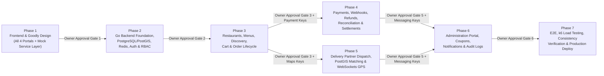

# Implementation Plan — Goodly Food Delivery Platform

**GitHub Repository**: `https://github.com/MridulS11/MyFoodAntigravity.git`

## 1. Roadmap Overview, Frontend-First Strategy & Testing Discipline

In strict compliance with **SRS Section 12** and the **Mandatory Testing Instructions**:
1. **Frontend-First Execution (Phase 1)**: We build all four web portals (**Customer**, **Restaurant**, **Delivery Partner**, **Administration**) first in **Next.js + React + TypeScript**, faithfully implementing the **Goodly** visual design from the reference screenshots. All components consume typed service contracts (`src/services/contracts/*`) backed by a stateful, clearly isolated mock adapter (`src/services/mocks/*`).
2. **Mandatory Per-Feature Test-Driven Loop**: For every feature in every phase, we strictly follow:
   - Write its tests (`Vitest` / `Go testing` / `Playwright`) $\rightarrow$ Implement the feature $\rightarrow$ Run the relevant tests $\rightarrow$ Identify and fix failures $\rightarrow$ Rerun tests $\rightarrow$ Record empirical results and screenshots in [`TEST_RESULTS.md`](file:///Users/m/.gemini/antigravity/brain/f69482ad-91cd-48c8-aad4-55af6ea4bc0f/TEST_RESULTS.md) and [`KNOWN_ISSUES.md`](file:///Users/m/.gemini/antigravity/brain/f69482ad-91cd-48c8-aad4-55af6ea4bc0f/KNOWN_ISSUES.md). Existing tests are never disabled, skipped, or weakened.
3. **Zero-Rebuild Backend Integration (Phases 2–6)**: As each Go backend module comes online in Phases 2–6, we swap the corresponding domain service implementation from `Mock*Service` to `Http*Service` (`/api/v1/*` + `/api/v1/ws`) without modifying React UI components.
4. **Strict Phase Completion & Approval Rules**: A phase is only submitted for approval when all required features are implemented, all unit/integration/Playwright tests pass, zero Critical/High defects remain, and the phase testing report (`TESTING_STRATEGY.md`, `TEST_CASES.md`, `TEST_RESULTS.md`, `KNOWN_ISSUES.md`) is updated with actual logs and screenshots.
5. **Scope Boundary**: The current release is **strictly Web-only** (desktop, tablet, and mobile browsers). Native Android and iOS apps are deferred to a future iteration (`SRS Section 1.2`).



---

## 2. Phase-by-Phase Execution Specification

---

### PHASE 1 — Frontend Development & Design Implementation (Frontend-First)

#### Objectives
Build the complete user interface, navigation architecture, responsive layouts, form validations, and interactive user journeys across all four web portals using the **Goodly** design language from the reference images, powered by a cleanly abstracted mock service layer.

#### Exact Features (`FR-001`–`FR-102` UI Layer + Final Business Decisions §1–§8)
- **Design System & Shared Components**: Goodly warm cream/gold/sage/mint theme tokens, typography, buttons, badges, modals, drawers, skeleton loaders, toast system, and map container abstraction.
- **Customer Portal (`(customer)`)**:
  - Discovery/Home page (`/`) matching `Screenshot ... 11.13.32 PM.png` (`Sunday Table` editorial hero, category filter pills, `Good things nearby` grid, address selector modal, filter drawer).
  - Global & dish search page (`/search`).
  - Restaurant Menu page (`/restaurants/[slug]`) matching `Screenshot ... 11.13.44 PM.png` (empty bag) and `11.14.01 PM.png` (inline `[- 1 +]` dish stepper, header `Your bag [1]`, sticky `YOUR ORDER` card), plus `ItemCustomizationModal` and `MultiRestaurantConflictModal`.
  - Checkout & Payment page (`/checkout`) with **Small-Cart Fee (`small_cart_fee_minor`)** when subtotal `< min_cart_threshold_minor` and distance-based delivery charge, Live Order Tracking page (`/orders/[id]/track`) with customer single-use Delivery OTP display, Order History & Receipts (`/orders`), **3-Category Post-Delivery Rating Modal** (1. Restaurant, 2. Individual Menu Items displayed below restaurant rating, 3. Delivery Partner — triggered automatically on app open after eligible delivery and accessible from `/orders`), and Customer Profile/Addresses/Favorites/Complaints (`/account/*`).
- **Outlet Owner & Branch Staff Portal (`(restaurant)`)**:
  - Multi-Outlet / Branch Switcher (`All Outlets [Consolidated]` for `OUTLET_OWNER`, branch-scoped for `BRANCH_MANAGER` / `OUTLET_STAFF`), Onboarding & KYC wizard (`/restaurant/onboarding`), Live Kitchen Display System Kanban (`/restaurant/orders`) with **5-minute acceptance countdown**, Customer Care escalation alert, and grace period indicator, Menu, **Flexible Scheduling** & Hybrid Stock Manager (`/restaurant/menu`), Operating Hours, **Max Simultaneous Active Orders Capacity Limit**, & **Branch Staff Granular Permission Manager** (`/restaurant/hours`), Consolidated Sales, **20% Commission** & Penalties dashboard (`/restaurant/earnings`).
- **Delivery Partner Portal (`(delivery)`)**:
  - Onboarding (`/delivery/onboarding`), Online/Offline shift toggle & **Simultaneous Broadcast Offer Modal** with atomic first-accept claim (`/delivery/dashboard`), Active Delivery step-by-step navigation, browser GPS sharing, & **Mandatory Rate-Limited Single-Use Delivery OTP Verification** (`/delivery/active/[id]`), Delivery History & **Base + Distance Earnings** (`/delivery/history`, `/delivery/earnings`).
- **Platform Administration (`PLATFORM_ADMIN`) & Customer Care (`CUSTOMER_CARE`) Portal (`(admin)`)**:
  - Strict role separation between `PLATFORM_ADMIN` (platform owner) and `CUSTOMER_CARE` (operational support role).
  - Executive & Customer Care Live Ops dashboard (`/admin/dashboard`) featuring the **5-Minute Acceptance Timeout Escalation Queue**, User & Role directory (`/admin/users`), Outlet & Delivery Partner KYC verification queues (`/admin/restaurants`, `/admin/delivery-partners`), Live Order & Fleet map monitor with delivery reassignment broadcast and **Authorized Delivery OTP Exception Override** (`/admin/orders`, `/admin/deliveries`), Transactions, Refunds & Outlet Penalty Ledger (`/admin/payments`, `/admin/refunds`), **20% Commission + Configurable Calculation Basis, Small-Cart Fee, Distance Delivery Pricing & Partner Payout Editor** (`/admin/commissions-pricing`, `/admin/promotions`), Service Areas (`/admin/service-areas`), Complaints desk (`/admin/complaints`), Audit Logs & Platform Timeouts Settings (`/admin/audit-logs`, `/admin/settings`).
- **Role Authentication Pages (`(auth)`)**: Login, Registration, OTP Verification, Password Reset, and Portal Role Switcher (`CUSTOMER`, `OUTLET_OWNER`, `BRANCH_MANAGER`, `DELIVERY_PARTNER`, `CUSTOMER_CARE`, `PLATFORM_ADMIN`).

#### Files & Modules to Be Created
```text
web/
├── package.json, tsconfig.json, next.config.ts, postcss.config.mjs
├── src/styles/globals.css, tokens.css
├── src/services/contracts/{auth,discovery,restaurant,menu,cart,order,payment,delivery,tracking,admin}.ts
├── src/services/mocks/{mockDb.ts, mockWebSocket.ts, *MockService.ts}
├── src/services/api/{httpClient.ts, wsClient.ts, *ApiService.ts}
├── src/stores/{useCartStore.ts, useAuthStore.ts, useLocationStore.ts}
├── src/lib/validators/{auth,address,menu,checkout,admin}.schema.ts
├── src/components/{ui/*, shared/*, customer/*, restaurant/*, delivery/*, admin/*}
└── src/app/{(customer)/*, (restaurant)/*, (delivery)/*, (admin)/*, (auth)/*}
```

#### Dependencies
- Node.js 20+, Next.js, React, TypeScript, Tailwind CSS, TanStack Query v5, Zustand, React Hook Form, Zod, Lucide Icons, Vitest + Playwright.
- **Clarification Dependency**: Resolution of Phase 1 UI/product questions in `REQUIREMENTS_CLARIFICATIONS.md`.

#### Deliverables
1. Complete runnable Next.js web application covering all 4 portals.
2. Pixel-accurate implementation of the supplied `goodly` reference screens.
3. Stateful cross-portal mock simulation (an order placed in Customer Portal immediately appears in Restaurant KDS, can be dispatched to Delivery Partner Portal, and monitored in Admin Portal).

#### Testing Requirements
- **Unit & Component Tests (Vitest + React Testing Library)**: Cart quantity stepper calculations, customization min/max validation, multi-restaurant cart conflict prompt, form validation schemas.
- **Visual & Responsive E2E Tests (Playwright)**: Desktop (`1440×900`), Tablet (`768×1024`), and Mobile (`390×844`) viewport verification across all 4 portals.

#### Acceptance Criteria & Definition of Completion
- [ ] All routes across Customer, Restaurant, Delivery Partner, and Admin portals render without console/hydration errors.
- [ ] Supplied reference screenshots (`11.13.32 PM`, `11.13.44 PM`, `11.14.01 PM`) are faithfully implemented.
- [ ] Mock data and mock services are 100% isolated behind `src/services/contracts/` interfaces.
- [ ] Automated component and Playwright navigation tests pass.
- [ ] **Phase Gate 1**: Project owner inspects the frontend and approves proceeding to Phase 2.

---

### PHASE 2 — Backend Foundation, Database, Auth & Core APIs

#### Objectives
Initialize the Go (Gin) modular monolith, configure Docker infrastructure (PostgreSQL 16 + PostGIS 3.4, Redis 7, RabbitMQ 3.13), execute all database migrations, implement JWT + Refresh Token + OTP authentication and granular RBAC, expose OpenAPI/Swagger UI, and wire Customer/Auth frontend flows to the live Go backend.

#### Exact Features
- Go project scaffolding (`cmd/api`, `cmd/ws`, `cmd/worker`) and configuration loader.
- Complete SQL migrations (`000001` through `000012`) creating all 46 tables, PostGIS extensions, enums, constraints, and GiST/GIN/B-Tree indexes defined in `DATABASE_DESIGN.md`.
- Authentication & Authorization module (`FR-001`–`FR-009`): Argon2id hashing, JWT access tokens, rotating refresh tokens with reuse detection, OTP verification, RBAC permission middleware, resource-ownership guards.
- Redis integration for rate limiting, session revocation, and caching primitives.
- Structured JSON logging (`slog`) with `X-Correlation-ID` propagation and `/health/live` + `/health/ready` endpoints.
- OpenAPI 3.0 spec serving interactive Swagger UI at `/swagger/index.html`.
- Core Customer profile and saved PostGIS address APIs (`/api/v1/customers/me/*`).

#### Files & Modules to Be Created
```text
.github/workflows/{ci.yml, milestone-verify.yml}
backend/
├── go.mod, go.sum, Makefile, Dockerfile
├── docker-compose.yml (postgres-postgis, redis, rabbitmq, minio)
├── migrations/*.up.sql, *.down.sql
├── api/openapi/openapi.yaml
├── cmd/{api,ws,worker,seed}/main.go
├── internal/config/config.go
├── internal/platform/{database,redis,rabbitmq,middleware,telemetry}/*
└── internal/modules/{auth,users}/*
```

#### Dependencies
- Phase 1 approval; Go 1.22+, Docker & Docker Compose, GitHub Actions configured on `https://github.com/MridulS11/MyFoodAntigravity.git`.

#### Deliverables
- Running Dockerized backend stack + SQL migrations + Reproducible seed/reset utility (`make db-seed`, `make db-reset-test` with non-production fail-safes) + Swagger UI + GitHub Actions CI pipeline + Live Auth & Customer Profile integration with Next.js frontend.

#### Testing Requirements
- **Unit Tests**: Password hashing, JWT signing/verification, RBAC permission evaluation, rate-limiter sliding window.
- **Integration Tests (Testcontainers)**: Full registration $\rightarrow$ OTP verify $\rightarrow$ login $\rightarrow$ token refresh $\rightarrow$ reuse revocation detection $\rightarrow$ PostGIS address creation and ownership enforcement (`403` on cross-user access).

#### Acceptance Criteria & Definition of Completion
- [x] `docker compose up` starts PostgreSQL+PostGIS, Redis, and RabbitMQ cleanly (MinIO replaced in local compose per deprecated hub image; S3 adapter deferred to Phase 6).
- [x] All up/down SQL migrations (`000001`–`000012`) execute cleanly and idempotently.
- [x] Role permissions and resource-level authorization pass positive and negative security tests.
- [x] Swagger UI (`/swagger/index.html`) is accessible and matches implemented endpoints.
- [ ] **Phase Gate 2**: Project owner approves proceeding to Phase 3.

---

### PHASE 3 — Restaurant, Menu, Discovery, Cart & Order Management

#### Objectives
Implement the complete restaurant onboarding/verification workflow, menu and customization management, PostGIS geo-discovery and search, authoritative backend cart and pricing engine, transactional order creation, and restaurant order acceptance and preparation state machine.

#### Exact Features
- Multi-outlet (branch) management under a single `OUTLET_OWNER` account, branch manager/staff invitations with granular branch-specific permissions (`outlet_staff_assignments`), KYC documents, operating/holiday hours, pause/resume toggle, and optional `max_concurrent_orders` capacity limit (`FR-070`, `FR-074`, `FR-016`, Final Business Decisions §2).
- Menu categories, items, flexible menu schedules (`menu_schedules`), customization groups/options, and hybrid item stock/availability (1-click toggle OR quantity-based inventory) (`FR-071`–`FR-073`, `FR-014`).
- PostGIS discovery feed (`ST_Covers`, `ST_DWithin`), full-text/trigram search, and filters (`FR-010`–`FR-015`).
- Redis menu & discovery caching with automatic post-commit + outbox cache invalidation.
- Backend cart management, multi-restaurant conflict enforcement (`FR-026`), coupon validation (`FR-023`), **Small-Cart Fee (`small_cart_fee_minor` when subtotal `< min_cart_threshold_minor`)**, and authoritative distance-based delivery charge/tax/fee calculation (`FR-017`–`FR-025`, Final Business Decisions §3).
- Transactional order creation with `Idempotency-Key`, inventory & capacity reservation, orthogonal state machine (`order_status`, `payment_status`, `delivery_status`), **5-minute default acceptance timeout $\rightarrow$ Customer Care alert $\rightarrow$ grace period $\rightarrow$ Admin-configured penalty (`outlet_penalties`)**, **3-Category Ratings** (Restaurant, Delivery Partner, Individual Menu Items + automatic app-open prompt), and Transactional Outbox publishing (`FR-027`–`FR-039`, `FR-075`, `FR-076`, Final Business Decisions §4 & §6).

#### Files & Modules to Be Created
```text
backend/internal/platform/outbox/{writer.go, relay.go}
backend/internal/modules/restaurants/{handler.go, service.go, repository.go, dto.go}
backend/internal/modules/menu/{handler.go, service.go, repository.go, dto.go}
backend/internal/modules/discovery/{handler.go, service.go, repository.go}
backend/internal/modules/cart/{handler.go, service.go, repository.go, pricing.go}
backend/internal/modules/orders/{handler.go, service.go, repository.go, statemachine.go}
```

#### Dependencies
- Phase 2 completion.

#### Deliverables
- Live end-to-end flow from Customer browsing `Sunday Table` $\rightarrow$ adding customized dishes $\rightarrow$ validating checkout $\rightarrow$ creating an order $\rightarrow$ Restaurant receiving, accepting, and marking the order `PREPARING` and `READY_FOR_PICKUP`.

#### Testing Requirements
- **Unit Tests**: Pricing/tax/discount calculator in minor units, state machine transition matrix (rejecting all invalid transitions), multi-restaurant cart guard.
- **Integration & Concurrency Tests**:
  - PostGIS boundary and radius queries (customer inside vs. outside service zone).
  - Concurrent checkout for an item with `available_quantity = 1` (verifying exactly 1 order succeeds and the second receives `409 ITEM_OUT_OF_STOCK`).
  - Duplicate `POST /api/v1/orders` with identical `Idempotency-Key` (verifying single DB row created).
  - Concurrent restaurant `Accept` vs. `Reject` race (verifying optimistic lock serialization).

#### Acceptance Criteria & Definition of Completion
- [x] Customer can place a valid order persisted transactionally in PostgreSQL, and Restaurant can receive, accept, and update preparation status in real time.
- [x] Redis cache invalidates immediately when a restaurant changes an item price or toggles availability.
- [ ] **Phase Gate 3**: Project owner approves proceeding to Phases 4 & 5 (and provides Payment Gateway & Google Maps sandbox API keys).

---

### PHASE 4 — Payment & Financial Operations

#### Objectives
Integrate the approved payment gateway (Razorpay / Cashfree / Stripe), implement cryptographic callback and webhook verification, idempotent transaction logging, automated and manual refund workflows, active background payment reconciliation, and restaurant/delivery settlement ledgers.

> [!IMPORTANT]
> **Third-Party API Keys Requested Before Phase 4 Execution**: Before starting Phase 4 implementation, we will prompt you for your sandbox/test credentials for the selected payment gateway (`RAZORPAY_KEY_ID`, `RAZORPAY_KEY_SECRET`, `RAZORPAY_WEBHOOK_SECRET` or Cashfree/Stripe equivalents).

#### Exact Features
- Payment session initiation (`FR-040`, `FR-041`).
- Dual-path payment verification: client callback verification + signed server-to-server webhook ingestion (`FR-042`, `FR-043`).
- Webhook deduplication (`UNIQUE (provider, provider_event_id)`) and idempotent state updates (`FR-044`, `NFR-012`).
- Automated refund initiation on restaurant rejection or eligible cancellation, plus Admin manual refund workflow (`FR-045`, `FR-046`, `FR-097`).
- Background Payment Reconciliation Worker querying gateway APIs for unresolved payments (`FR-048`, `NFR-015`).
- Platform commission calculation (**20% initial commission** + **Admin-configurable calculation basis** with immutable snapshots), `restaurant_settlements` accrual, `delivery_partner_earnings` calculation (**base pay + distance-based per-unit pay**), and double-entry `financial_ledger_entries` (`FR-077`, `FR-085`, `FR-098`, Final Business Decisions §3 & §8).

#### Files & Modules to Be Created
```text
backend/internal/platform/providers/paymentgw/{provider.go, razorpay.go, cashfree.go, mock.go}
backend/internal/modules/payments/{handler.go, service.go, webhook.go, reconciler.go, settlement.go, repository.go}
```

#### Dependencies
- Phase 3 completion + Payment Gateway sandbox credentials.

#### Deliverables
- Complete online payment capture, webhook processing, refund execution, reconciliation worker, and settlement ledger generation.

#### Testing Requirements
- **Security & Consistency Tests**:
  - Tampered webhook signature rejection (`401`).
  - Replaying the exact same `payment.captured` webhook 10 times concurrently (verifying single state transition and single outbox event).
  - Simulated lost webhook recovered by the background reconciliation worker.
  - Late payment webhook arriving after order timeout (verifying automatic refund queuing).
  - Double-refund prevention test.

#### Acceptance Criteria & Definition of Completion
- [x] Payments and refunds are processed and recorded with 100% ledger accuracy in minor units.
- [x] Duplicate webhooks never cause duplicate financial records or duplicate restaurant notifications.
- [ ] **Phase Gate 4**: Project owner approves proceeding to Phase 5.

---

### PHASE 5 — Delivery Management & Real-Time Tracking

#### Objectives
Implement delivery partner onboarding and availability management, PostGIS/Redis spatial broadcast dispatch engine with atomic first-accept locking and sibling offer expiration, WebSocket real-time hub (`/api/v1/ws`), browser GPS location collection and validation, Redis Geo storage, dynamic Google Maps ETA calculation, mandatory rate-limited single-use OTP Proof of Delivery, and live customer/admin delivery tracking.

> [!IMPORTANT]
> **Third-Party API Keys Requested Before Phase 5 Execution**: Before starting Phase 5 external routing integration, we will prompt you for your Google Maps Platform API keys (`GOOGLE_MAPS_SERVER_API_KEY`, `NEXT_PUBLIC_GOOGLE_MAPS_BROWSER_KEY`).

#### Exact Features
- Delivery partner onboarding, document submission, and online/offline shift management (`FR-049`, `FR-078`, `FR-079`).
- Eligibility filtering (`ONLINE_AVAILABLE`, verified, not busy, within zone/radius) (`FR-050`–`FR-052`).
- **Simultaneous Broadcast Offer Dispatch** to all eligible delivery partners (`FR-053`, Final Business Decisions §5), **atomic first-accept locking** (`FR-054`, `FR-056`) that marks the winning partner `ON_DELIVERY` (busy) and immediately expires all sibling offers (`SUPERSEDED`), reassignment broadcast if an assignment is cancelled/invalidated (`FR-057`), and escalation to `UNASSIGNABLE` Customer Care / Admin queue (`FR-058`).
- Pickup confirmation, transit status updates, and **backend-controlled, single-use, time-limited, rate-limited OTP Proof of Delivery (`delivery_otps`)** for every order (both online & COD), plus separately authorized Customer Care / Admin exception override (`FR-080`–`FR-083`, Final Business Decisions §7).
- Real-time GPS ingestion (`FR-059`–`FR-061`), rate throttling (`FR-067`), WebSocket room authorization (`FR-068`) and Redis Pub/Sub broadcast (`FR-062`–`FR-064`), Google Maps ETA updates (`FR-065`), disconnect catch-up (`FR-066`), and batch breadcrumb persistence to partitioned `delivery_tracking_history` (`FR-069`).

#### Files & Modules to Be Created
```text
backend/internal/platform/websocket/{hub.go, client.go, rooms.go, pubsub.go}
backend/internal/platform/providers/maps/{provider.go, google_maps.go, mock.go}
backend/internal/modules/delivery/{handler.go, service.go, dispatcher.go, timeout_worker.go, repository.go}
backend/internal/modules/tracking/{handler.go, ingest.go, eta.go, batch_persister.go, repository.go}
```

#### Dependencies
- Phase 3 & 4 completion + Google Maps API keys.

#### Deliverables
- Complete real-time logistics pipeline from restaurant acceptance $\rightarrow$ partner offer & acceptance $\rightarrow$ pickup $\rightarrow$ live browser GPS tracking on customer map $\rightarrow$ PIN-confirmed delivery completion.

#### Testing Requirements
- **Concurrency & Real-Time Tests**:
  - 5 delivery partners attempting to accept the same delivery assignment simultaneously (verifying atomic lock assigns exactly 1 partner).
  - Offer timeout expiration vs. late accept race test.
  - WebSocket unauthorized room subscription test (Customer A attempting to subscribe to Customer B's `order:{id}` room $\rightarrow$ `403`).
  - Simulated WebSocket drop and reconnect catch-up verification.

#### Acceptance Criteria & Definition of Completion
- [ ] Complete test order travels through restaurant acceptance, delivery assignment, pickup, live map tracking, and final delivery.
- [ ] Web browser geolocation limitations and wake-lock/fallback behaviors are documented and verified.
- [ ] **Phase Gate 5**: Project owner approves proceeding to Phase 6.

---

### PHASE 6 — Administration, Notifications, Promotions & Platform Completion

#### Objectives
Complete all administrative portal backend operations, role-based admin permissions, immutable security audit logging, multi-channel notification infrastructure (WebSocket, FCM Web Push, SMS, Email), promotional campaigns/coupons, customer complaints resolution, and operational analytics reports.

> [!IMPORTANT]
> **Third-Party API Keys Requested Before Phase 6 Execution**: Before wiring live external messaging providers in Phase 6, we will request credentials for Firebase Cloud Messaging (`FCM_SERVICE_ACCOUNT`), SMS/OTP provider, Email provider (`AWS_SES` / `RESEND`), and `AWS_S3` bucket credentials.

#### Exact Features
- Admin management of customers (`FR-092`), restaurant KYC verification (`FR-093`), and delivery partner verification (`FR-094`).
- Admin live order & delivery monitoring with manual dispatch/cancellation interventions (`FR-095`, `FR-096`).
- Admin refund management, commission configuration, delivery charge tiers, and PostGIS service zone management (`FR-097`, `FR-098`).
- Promotional campaigns and coupon management (`FR-099`).
- Customer complaints and support ticket workflow (`FR-100`).
- Multi-channel notification consumers and browser Web Push integration (`FR-086`–`FR-091`).
- Operational and financial reporting APIs (`FR-101`) and immutable `admin_audit_logs` (`FR-102`).

#### Files & Modules to Be Created
```text
backend/internal/platform/providers/{notify_fcm.go, notify_sms.go, notify_email.go, storage_s3.go}
backend/internal/modules/notifications/{handler.go, consumer.go, service.go, repository.go}
backend/internal/modules/promotions/{handler.go, service.go, repository.go}
backend/internal/modules/admin/{handler.go, service.go, reports.go, audit.go, repository.go}
```

#### Dependencies
- Phases 2–5 completion + Notification & Storage provider credentials.

#### Deliverables
- Fully integrated 4-portal platform with RBAC-enforced Admin operations, audit logging, promotions, complaints, and notifications.

#### Testing Requirements
- **Integration Tests**: Admin permission matrix tests (`SUPPORT_ADMIN` blocked from changing commission rates; `FINANCE_ADMIN` blocked from modifying service zones), audit log completeness verification on every admin write, coupon budget/usage cap concurrency tests.

#### Acceptance Criteria & Definition of Completion
- [ ] Administrators can verify restaurants/partners, monitor live operations, resolve complaints, issue refunds, configure commissions/zones/coupons, and inspect audit logs.
- [ ] **Phase Gate 6**: Project owner approves proceeding to Phase 7.

---

### PHASE 7 — Testing, Optimization, Hardening & Deployment

#### Objectives
Execute full end-to-end, consistency, security, browser-compatibility, and `k6` performance load testing; optimize SQL queries and indexes based on empirical telemetry; verify backup/recovery and failure recovery procedures; and finalize production Docker/AWS deployment and operational documentation.

#### Exact Features & Activities (`SRS Section 11 & Phase 7`)
- **Full E2E Test Suite (Playwright)**: Automated multi-context tests running Customer, Restaurant, Delivery Partner, and Admin browser sessions simultaneously through all 10 mandatory business workflows (`TC-WF-001` through `TC-WF-010`) with automated screenshot capture and database state verification.
- **Consistency Chaos Suite**: Automated verification of all 11 scenarios in `RISK_AND_CONSISTENCY.md` (container kill during checkout, RabbitMQ redelivery, concurrent accepts, Redis flush recovery).
- **Load & Performance Suite (`k6`)**: Progressive concurrency testing (`p50`, `p95`, `p99` latency, RPS, HTTP error rates, CPU/memory, PostgreSQL connection pool utilization, Redis latency/hit rate, RabbitMQ queue processing delay) against SRS Section 8.1 targets with `EXPLAIN (ANALYZE, BUFFERS)` query tuning.
- **Security Audit (`OWASP ZAP` + Security Suite)**: Automated OWASP ZAP baseline & OpenAPI scan (`zap-baseline.py`, `zap-api-scan.py`), unauthorized access & RBAC tests, cross-user IDOR tests, SQL injection & XSS verification, CSRF protection, rate-limiting verification, and payment webhook HMAC verification.
- **Deployment & Observability**: Production `docker-compose.prod.yml` / AWS ECS definitions, Prometheus alert rules, Grafana dashboards (`API Latency`, `Order Funnel`, `RabbitMQ & Outbox Health`, `WebSocket & Tracking Load`), PostgreSQL `pg_dump` / PITR backup & restore runbook, and finalized `TESTING_STRATEGY.md`, `TEST_CASES.md`, `TEST_RESULTS.md`, and `KNOWN_ISSUES.md`.

#### Files & Modules to Be Created
```text
test/e2e/full_order_lifecycle.spec.ts
test/consistency/{idempotency_test.go, concurrency_race_test.go, recovery_test.go}
test/load/{discovery_load.js, checkout_spike.js, tracking_ws_load.js}
deploy/{prometheus.yml, alerts.yml, grafana/dashboards/*.json}
docs/{DEPLOYMENT_AND_OPS.md, PERFORMANCE_AND_CONSISTENCY_REPORT.md, KNOWN_LIMITATIONS.md}
```

#### Deliverables
- Complete source code, automated test suites, empirical performance & consistency test reports, monitoring dashboards, and production deployment & recovery documentation (`SRS Section 13`).

#### Acceptance Criteria & Definition of Completion
- [ ] All SRS Section 14 Acceptance Criteria verified and signed off.
- [ ] Empirical load test report confirms performance and consistency targets under concurrent load.
- [ ] Backup, restore, and graceful restart procedures verified.
