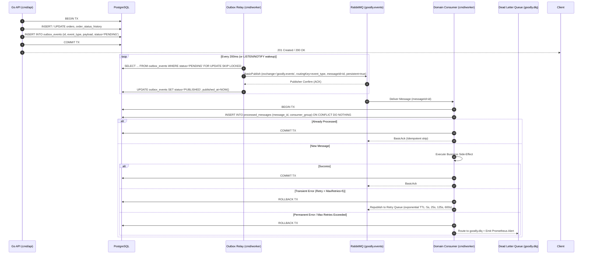
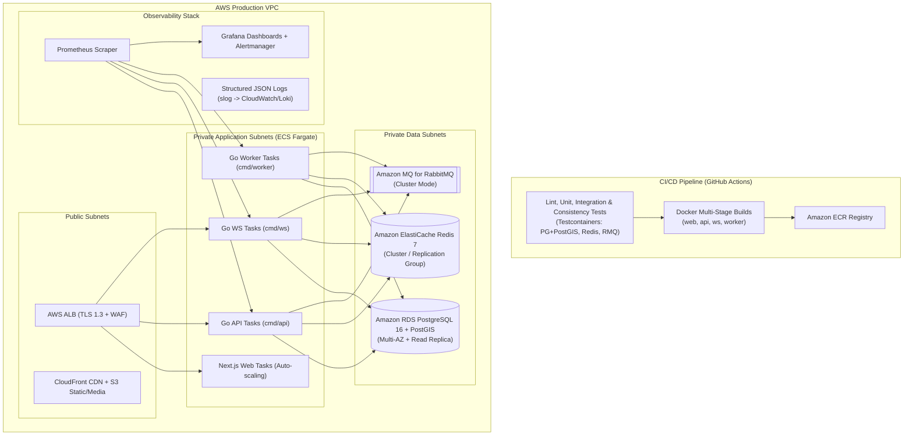

# Technical Architecture — Goodly Food Delivery Platform

## 1. Executive Summary & Architectural Philosophy

The **Goodly Food Delivery Platform** is a multi-role, real-time web ecosystem connecting **Customers**, **Restaurants**, **Delivery Partners**, and **Administrators**. In alignment with the Software Requirements Specification (SRS v1.0), this architecture prioritizes **transactional data consistency (Priority 1)**, **low-latency performance (Priority 2)**, and **operational fault tolerance (Priority 3)**.

### Why a Modular Monolith (With Selective Process Isolation)
Prematurely decomposing a transactional marketplace into distributed microservices introduces distributed transaction hazards (two-phase commits, network partitions during checkout, eventual consistency lag between order creation and inventory reservation) and operational overhead.

Instead, the backend is architected as a **strict Modular Monolith in Go (Gin)** backed by a single authoritative **PostgreSQL + PostGIS** database, **Redis**, and **RabbitMQ**:
1. **Strict Compile-Time Domain Boundaries**: Each of the 13 business domains resides in an isolated internal Go package (`internal/modules/<domain>`) exposing only a narrow service interface and DTOs. Cross-module database table mutations are forbidden; for example, only the `orders` module may mutate the `orders` table (SRS Section 5.3).
2. **ACID Transactions Across Core Workflows**: Validating cart items, reserving stock, creating the order record, recording the initial status transition, and enqueueing an outbox event occur inside a **single PostgreSQL ACID transaction**.
3. **Multi-Entrypoint Deployment from One Codebase**: The single Go repository compiles into three lightweight binary entrypoints (`cmd/api`, `cmd/ws`, `cmd/worker`) that share domain packages. In initial deployments, they can run as unified or side-by-side containers; under high load, the WebSocket hub (`cmd/ws`), HTTP API (`cmd/api`), and RabbitMQ background consumers (`cmd/worker`) scale horizontally and independently without any code rewrite.
4. **Mobile-Ready API Contract**: All business rules, pricing calculations, state transitions, and RBAC checks reside in the Go backend behind versioned REST (`/api/v1/*`) and WebSocket (`/api/v1/ws`) endpoints. Future native iOS and Android applications (Customer and Delivery Partner) will consume these exact endpoints without duplicating business logic.

---

## 2. High-Level System Architecture & Data Flow

```mermaid
flowchart TB
    subgraph Clients["Web Portals (Next.js + React + TypeScript)"]
        CustWeb["Customer Web Portal<br/>(Discovery, Cart, Checkout, Live Track)"]
        RestWeb["Restaurant Web Portal<br/>(KDS Orders, Menu, Availability, Reports)"]
        DelivWeb["Delivery Partner Web Portal<br/>(Shifts, Offers, Navigation, Browser GPS)"]
        AdminWeb["Administration Web Portal<br/>(Verification, Live Ops, Refunds, Config)"]
    end

    subgraph Edge["Edge & Load Balancing"]
        CDN["CloudFront / CDN<br/>(Static Assets & Media)"]
        ALB["Application Load Balancer<br/>(HTTPS / WSS Termination)"]
    end

    subgraph Backend["Go Modular Monolith Runtime (Gin)"]
        API["HTTP API Server (cmd/api)<br/>REST /api/v1/* + OpenAPI"]
        WSHub["WebSocket Hub Server (cmd/ws)<br/>Real-time Rooms & Location Ingest"]
        Worker["Async Worker Server (cmd/worker)<br/>Outbox Relay, Dispatch, Reconciler"]
    end

    subgraph DataStores["Data & Messaging Infrastructure"]
        PG[("PostgreSQL 16 + PostGIS 3.4<br/>Authoritative System of Record")]
        Redis[("Redis 7<br/>Cache, Geo Index, Pub/Sub, Rate Limit")]
        RMQ[["RabbitMQ 3.13<br/>Durable Exchanges, Retry & DLQ"]]
    end

    subgraph External["External Third-Party Providers"]
        PayGW["Payment Gateway<br/>(Razorpay / Cashfree / Stripe)"]
        GMaps["Google Maps Platform<br/>(Geocoding, Places, Routes/ETA)"]
        Notif["Notification Providers<br/>(FCM Web Push, SMS/OTP, SES Email)"]
        S3["Object Storage (AWS S3)<br/>(Menu Photos, KYC Docs)"]
    end

    CustWeb & RestWeb & DelivWeb & AdminWeb -->|HTTPS REST| ALB
    CustWeb & RestWeb & DelivWeb & AdminWeb <-->|WSS WebSockets| ALB
    ALB --> API
    ALB --> WSHub

    API -->|ACID Tx & PostGIS Queries| PG
    API -->|Cache / Rate Limit / Geo Read| Redis
    WSHub <-->|Pub/Sub & Live Partner Geo| Redis
    WSHub -->|Location Batch Persist| PG

    Worker -->|Poll outbox_events| PG
    Worker -->|Publish & Consume| RMQ
    Worker -->|Update State / Reconcile| PG
    Worker -->|Publish WS Events| Redis

    API & Worker -->|Signed API & Webhooks| PayGW
    API & Worker -->|Routes & Geocoding| GMaps
    Worker -->|Push / SMS / Email| Notif
    API -->|Presigned Upload URLs| S3
    S3 --> CDN
```



### How Data Moves Between Components
1. **Synchronous Reads (Discovery & Menus)**: The Next.js frontend issues `GET /api/v1/restaurants` with customer coordinates. `cmd/api` checks Redis for cached menu/restaurant metadata and executes a PostGIS `ST_DWithin` + `ST_Covers` query against PostgreSQL to filter serviceable restaurants, returning results in `<200ms` (p95 target).
2. **Transactional Writes (Checkout & Order Placement)**: Customer submits `POST /api/v1/orders` with an `Idempotency-Key` header. `cmd/api` validates item availability and prices directly against PostgreSQL (never trusting frontend prices or stale Redis cache), inserts the `orders`, `order_items`, and `outbox_events` rows in a single PostgreSQL transaction, and initiates payment with the Payment Gateway.
3. **Asynchronous Event Processing (Transactional Outbox -> RabbitMQ)**: The `OutboxRelay` in `cmd/worker` polls uncommitted rows from `outbox_events` (`FOR UPDATE SKIP LOCKED`), publishes persistent messages to RabbitMQ (`goodly.events` exchange), and marks them published. Consumers process downstream tasks (notifying the restaurant, initiating delivery dispatch, generating invoices, recording analytics) idempotently.
4. **Real-Time Propagation (Redis Pub/Sub -> WebSockets)**: When an order status changes or a delivery partner sends a GPS coordinate, the backend publishes a structured event to a Redis Pub/Sub channel (`ws:order:{id}`, `ws:restaurant:{id}`, `ws:partner:{id}`). Every `cmd/ws` instance subscribed to that room pushes the frame over active WebSocket connections within `<1s` (status) or `<2s` (location).

---

## 3. Frontend Architecture (TypeScript, React, Next.js)

### 3.1 Application Structure & Routing Strategy
All four portals live inside a unified **Next.js (App Router, TypeScript strict mode)** codebase using Next.js **Route Groups** so each portal has its own dedicated layout shell, navigation chrome, and role-guard middleware while sharing core design tokens, UI primitives, Zod validators, and API client infrastructure:

```text
web/
├── src/
│   ├── app/
│   │   ├── (customer)/           # Customer Portal (goodly editorial layout)
│   │   ├── (restaurant)/         # Restaurant Management & Kitchen Display Portal
│   │   ├── (delivery)/           # Delivery Partner Mobile-First Web Portal
│   │   ├── (admin)/              # Administration & Live Ops Portal
│   │   └── (auth)/               # Role-aware Auth, Registration & OTP flows
│   ├── components/
│   │   ├── ui/                   # Atomic primitives (Button, Badge, Modal, Drawer, Input, Skeleton)
│   │   ├── shared/               # MapView, StatusBadge, PriceDisplay, AddressAutocomplete
│   │   ├── customer/             # HeroPromo, CategoryPills, RestaurantCard, MenuItemRow, StickyBagCard
│   │   ├── restaurant/           # IncomingOrderCard, KitchenKanban, MenuEditor, PrepTimer
│   │   ├── delivery/             # AvailabilityToggle, OfferModal, NavigationMap, PickupChecklist
│   │   └── admin/                # VerificationQueue, LiveOpsMap, RefundDrawer, AuditLogTable
│   ├── services/
│   │   ├── contracts/            # TypeScript interfaces (IAuthService, IOrderService, etc.)
│   │   ├── api/                  # Production HTTP + WebSocket implementation (/api/v1/*)
│   │   ├── mocks/                # Deterministic Phase 1 mock service + fixtures (Sunday Table, etc.)
│   │   └── index.ts              # Dependency-injected service provider (env-switched)
│   ├── stores/                   # Zustand stores (Cart, ActiveLocation, WSConnectionState, AudioAlerts)
│   ├── hooks/                    # TanStack Query hooks + useWebSocketSubscription + useGeolocation
│   ├── lib/                      # Zod schemas, currency formatters, RBAC helpers
│   └── styles/                   # Tailwind CSS + Goodly CSS custom properties (tokens from reference UI)
```

### 3.2 Frontend-First Service Abstraction (Phase 1 -> Phase 2+ Transition)
To satisfy the requirement that **Frontend is built first using clearly separated mock data and API-ready service interfaces without requiring a rebuild during backend integration**:
- Components **never** call `fetch()` or import mock JSON directly.
- Components call React Query hooks (`useRestaurantMenu(slug)`, `useCreateOrder()`), which invoke methods on typed service interfaces defined in `src/services/contracts/`.
- During **Phase 1**, `src/services/index.ts` binds the interfaces to `MockDataService` (backed by stateful `sessionStorage`/`IndexedDB` persistence so adding items to the bag, placing an order, accepting it in the Restaurant portal, and delivering it in the Delivery portal work interactively across tabs).
- During **Phase 2–6**, binding switches per domain via environment configuration (`NEXT_PUBLIC_API_MODE=live`) to `HttpApiService` (generated from the OpenAPI 3.0 spec), requiring **zero changes** to React components or pages.

### 3.3 State Management & Real-Time Client Architecture
- **Server State**: Managed via **TanStack Query v5** with deterministic query keys (`['restaurant', slug]`, `['order', orderId]`).
- **Cart & Address State**: Managed via **Zustand** synced with backend `/api/v1/cart` when authenticated, or persisted locally for guest browsing prior to checkout authentication.
- **WebSocket Synchronization**: A singleton `WebSocketManager` maintains a persistent connection to `/api/v1/ws`. Incoming WebSocket events (`order.status_updated`, `restaurant.new_order`, `delivery.offer_received`, `tracking.location_updated`) directly update the TanStack Query cache via `queryClient.setQueryData()` and trigger invalidations on reconnect.

---

## 4. Backend Architecture (Go + Gin Modular Monolith)

### 4.1 Directory Layout
```text
backend/
├── cmd/
│   ├── api/main.go               # HTTP REST API server entrypoint
│   ├── ws/main.go                # Real-time WebSocket hub & location ingestion entrypoint
│   └── worker/main.go            # RabbitMQ consumer, Outbox relay & cron scheduler entrypoint
├── internal/
│   ├── config/                   # Viper/env configuration & startup validation
│   ├── platform/                 # Shared technical infrastructure
│   │   ├── database/             # pgxpool, TxManager (WithTx helper), migration runner
│   │   ├── redis/                # go-redis client, Geo helpers, distributed locks, Pub/Sub
│   │   ├── rabbitmq/             # AMQP connection pool, publisher, consumer wrapper with DLQ
│   │   ├── outbox/               # Transactional Outbox writer & polling relay
│   │   ├── websocket/            # Client hub, room authorization, Redis Pub/Sub fanout bridge
│   │   ├── middleware/           # Auth JWT, RBAC, RateLimiter, Idempotency, CorrelationID, Recovery
│   │   ├── telemetry/            # Prometheus metrics, slog structured logger
│   │   └── providers/            # Interfaces & adapters for PaymentGW, GoogleMaps, S3, SMS, Email, FCM
│   └── modules/                  # 13 Isolated Business Domain Modules
│       ├── auth/
│       ├── users/
│       ├── restaurants/
│       ├── menu/
│       ├── discovery/
│       ├── cart/
│       ├── orders/
│       ├── payments/
│       ├── delivery/
│       ├── tracking/
│       ├── notifications/
│       ├── promotions/
│       └── admin/
├── migrations/                   # Sequential SQL migrations (golang-migrate)
├── api/openapi/                  # OpenAPI 3.0 specification & Swagger UI assets
└── test/                         # Integration, E2E, Consistency & k6 load test suites
```

### 4.2 Detailed Breakdown of the 13 Backend Modules

Each module follows a strict internal layered architecture: `handler.go` (Gin HTTP transport & DTO binding) $\rightarrow$ `service.go` (business rules & transaction boundaries) $\rightarrow$ `repository.go` (parameterized SQL queries via `pgx`).

---

#### Module 1: Authentication and Authorization (`internal/modules/auth`)
- **Responsibilities**: Customer (`CUSTOMER`), Outlet Owner (`OUTLET_OWNER`), Branch Manager / Outlet Staff (`BRANCH_MANAGER`, `OUTLET_STAFF`), Delivery Partner (`DELIVERY_PARTNER`), Customer Care (`CUSTOMER_CARE`), and Platform Admin (`PLATFORM_ADMIN`) registration/login (`FR-001`–`FR-003`); SMS/Email OTP generation and verification (`FR-004`); password recovery (`FR-005`); short-lived JWT Access Token (`15m`) + rotating HttpOnly Refresh Token (`7d`) session management (`FR-008`); strict role separation (`PLATFORM_ADMIN` vs. `CUSTOMER_CARE` vs. `OUTLET_OWNER`), branch-scoped RBAC via `outlet_staff_assignments`, and resource-ownership middleware (`FR-006`, `FR-007`); step-up verification for sensitive account edits (`FR-009`).
- **APIs**: `POST /api/v1/auth/register`, `POST /api/v1/auth/login`, `POST /api/v1/auth/otp/send`, `POST /api/v1/auth/otp/verify`, `POST /api/v1/auth/refresh`, `POST /api/v1/auth/logout`, `POST /api/v1/auth/password/forgot`, `POST /api/v1/auth/password/reset`, `POST /api/v1/auth/ws-ticket`.
- **Database & Redis Interactions**:
  - Reads/Writes PostgreSQL: `users`, `roles`, `user_roles`, `admin_permissions`, `role_permissions`, `outlet_staff_assignments`, `auth_sessions`, `otp_verifications`.
  - Reads/Writes Redis: `ratelimit:otp:{phone_or_ip}`, `session:revoked:{jti}`, `ws:ticket:{nonce}` (single-use 30s ticket for WebSocket handshake).
- **Dependencies**: `notifications` (for dispatching OTP SMS/Email), Argon2id password hasher.
- **Failure Cases & Mitigations**:
  - *Brute-force login / OTP flooding*: Redis sliding-window rate limiter (max 5 failed logins / 15 min per account; max 3 OTP sends / 10 min per phone/IP) + exponential lockout.
  - *Compromised refresh token reuse*: Refresh tokens store a `token_family_id`; if a rotated token is presented twice, the entire family is revoked in PostgreSQL and Redis immediately.

---

#### Module 2: User and Profile Management (`internal/modules/users`)
- **Responsibilities**: Manage customer personal profiles (`FR-001`), saved delivery addresses with geocoded PostGIS points, favorite restaurants, and account deactivation/privacy requests. Enforces strict ownership (`customer_id == jwt.sub`).
- **APIs**: `GET/PATCH /api/v1/customers/me`, `GET/POST /api/v1/customers/me/addresses`, `PATCH/DELETE /api/v1/customers/me/addresses/:id`, `GET/POST/DELETE /api/v1/customers/me/favorites/:restaurantId`.
- **Database Interactions**: `users`, `customer_profiles`, `customer_addresses` (stores `location GEOGRAPHY(Point, 4326)`), `customer_favorites`.
- **Dependencies**: `platform/providers/maps` (geocoding verification on address save), `discovery` (checking service zone containment).
- **Failure Cases & Mitigations**:
  - *Deleting an address used by an active order*: Address deletion is soft-deleted (`is_archived = true`), and active orders always store an immutable JSON/column snapshot of the delivery address and coordinates at checkout time.

---

#### Module 3: Restaurant & Multi-Outlet Management (`internal/modules/restaurants`)
- **Responsibilities**: Multi-outlet (branch) management under a single `OUTLET_OWNER` account with consolidated owner access across all owned branches (Final Business Decisions §2); branch manager (`BRANCH_MANAGER`) and staff (`OUTLET_STAFF`) invitations with granular, branch-specific permissions (`outlet_staff_assignments`); outlet onboarding application and KYC/license document uploads (`FR-070`); operating hours, holiday hours (`outlet_holiday_closures`), and temporary pause/resume toggle (`FR-074`, `FR-016`); prep-time configuration; optional/toggleable **maximum simultaneous active orders** (`max_concurrent_orders`) capacity limit per outlet; and consolidated/per-branch sales, settlement, and penalty reporting (`FR-077`).
- **APIs**: `POST /api/v1/restaurants/onboarding`, `GET /api/v1/outlets`, `GET/PATCH /api/v1/restaurants/me`, `GET/POST/PATCH/DELETE /api/v1/outlets/:outletId/staff`, `PUT /api/v1/restaurants/me/operating-hours`, `PATCH /api/v1/restaurants/me/availability`, `POST /api/v1/restaurants/me/documents`, `GET /api/v1/restaurants/me/reports/sales`, `GET /api/v1/restaurants/me/settlements`.
- **Database & Redis Interactions**:
  - PostgreSQL: `restaurants`, `outlet_staff_assignments`, `restaurant_documents`, `restaurant_operating_hours`, `outlet_holiday_closures`, `restaurant_settlements`, `outlet_penalties`.
  - Redis: Invalidates `cache:restaurant:{id}:meta` and updates `restaurant:open_status:{id}` immediately upon availability or capacity change.
- **Dependencies**: `platform/providers/s3` (presigned upload URLs), `outbox` (emits `restaurant.availability_changed`).
- **Failure Cases & Mitigations**:
  - *Unverified outlet attempting to go online*: Guarded by DB check constraint and service check (`verification_status == 'APPROVED'`).
  - *Branch Manager attempting cross-branch access*: Blocked by branch-scoped RBAC middleware checking `outlet_staff_assignments (user_id, outlet_id, status = 'ACTIVE')` and required permission slug.

---

#### Module 4: Menu, Scheduling and Category Management (`internal/modules/menu`)
- **Responsibilities**: CRUD for menu categories (`FR-071`), menu items (`FR-072`), customization groups and add-on options, item prices, flexible **menu scheduling** (`menu_schedules` for time-of-day and day-of-week availability windows), and real-time item stock/availability supporting both a simple available/unavailable toggle and quantity-based inventory (`FR-073`, `FR-014`).
- **APIs**: `GET /api/v1/restaurants/:id/menu`, `POST/PATCH/DELETE /api/v1/menu/categories/:id`, `POST/PATCH/DELETE /api/v1/menu/items/:id`, `PATCH /api/v1/menu/items/:id/availability`, `GET/POST/DELETE /api/v1/menu/schedules`, `POST/PATCH/DELETE /api/v1/menu/items/:id/customizations`.
- **Database & Redis Interactions**:
  - PostgreSQL: `menu_categories`, `menu_items`, `menu_schedules`, `menu_customization_groups`, `menu_customization_options`, `menu_item_inventory`.
  - Redis: Caches public menu tree at `cache:restaurant:{id}:menu` (TTL 10m); explicitly evicted on any menu, schedule, or inventory mutation.
- **Dependencies**: `restaurants` (ownership & branch permission verification).
- **Failure Cases & Mitigations**:
  - *Price, schedule, or customization edited while customers have items in carts*: `menu_items` maintains a `version` counter. Checkout re-evaluates live PostgreSQL prices, schedule windows, and availability (`FR-020`, `FR-024`) and returns a structured `409 CART_PRICE_OR_AVAILABILITY_CHANGED` diff if items changed since being added to the cart.

---

#### Module 5: Search and Discovery (`internal/modules/discovery`)
- **Responsibilities**: Geo-aware discovery of serviceable outlets (`FR-010`, `FR-015`), full-text + trigram search across restaurants and dishes (`FR-011`), multi-criteria filtering (cuisine, rating, delivery time, dietary tags, free delivery/offers) (`FR-012`), live operating status calculation (including `max_concurrent_orders` capacity check and holiday hours) (`FR-013`), and distance-based delivery fee/time estimation for the selected customer coordinate.
- **APIs**: `GET /api/v1/discovery/restaurants`, `GET /api/v1/discovery/search`, `GET /api/v1/discovery/categories`, `GET /api/v1/discovery/serviceability?lat=...&lng=...`.
- **Database & Redis Interactions**:
  - PostgreSQL + PostGIS: Uses `ST_Covers(service_zones.boundary, $cust_point)` and `ST_DWithin(restaurants.location, $cust_point, restaurants.max_delivery_radius_meters)` backed by `GIST` spatial indexes and `pg_trgm` / `tsvector` GIN indexes on restaurant and dish names.
  - Redis: Caches discovery feed tiles by Quantized Geohash (precision 6, `~1.2km x 0.6km`) for 60 seconds (`cache:discovery:{geohash6}:{filter_hash}`).
- **Dependencies**: `restaurants`, `menu`, `promotions`.
- **Failure Cases & Mitigations**:
  - *Address outside service area*: Returns `serviceable: false` with nearest active zone metadata so the UI clearly renders an out-of-zone state rather than an empty error screen.

---

#### Module 6: Cart and Pricing (`internal/modules/cart`)
- **Responsibilities**: Add/update/remove cart items and customizations (`FR-017`–`FR-019`), enforce the single-restaurant cart policy (`FR-026`), validate item availability, menu schedule windows, and outlet active order capacity (`FR-020`), validate coupons (`FR-023`), and authoritatively compute subtotal, **small-cart fee (`small_cart_fee_minor`, applied only when subtotal falls below the Admin-configured `min_cart_threshold_minor`)**, packaging charges, GST/taxes, **distance-based delivery fees** (supporting zone and systemwide defaults), and discounts on the backend (`FR-021`, `FR-022`, `FR-024`, `FR-025`, Final Business Decisions §3).
- **APIs**: `GET /api/v1/cart`, `POST /api/v1/cart/items`, `PATCH /api/v1/cart/items/:itemId`, `DELETE /api/v1/cart/items/:itemId`, `DELETE /api/v1/cart`, `POST /api/v1/cart/apply-coupon`, `DELETE /api/v1/cart/remove-coupon`, `POST /api/v1/cart/validate-checkout`.
- **Database Interactions**: `carts`, `cart_items`, `cart_item_customizations`, `delivery_charge_rules`, `menu_items`, `restaurants`.
- **Dependencies**: `menu`, `promotions`, `discovery` (road distance calculation).
- **Failure Cases & Mitigations**:
  - *Multi-restaurant conflict*: Adding an item from a second restaurant returns `409 MULTI_RESTAURANT_CART_CONFLICT` with the conflicting restaurant name so the frontend prompts "Replace cart items from Sunday Table with Little Green Bowl?".
  - *Stale cart at checkout*: `validate-checkout` returns a cryptographic `pricing_quote_hash` (HMAC of items, quantities, address, coupon, small-cart fee, distance fee, and calculated total minor units). `POST /api/v1/orders` verifies that the freshly computed backend total matches the customer's acknowledged `pricing_quote_hash`.

---

#### Module 7: Order Management, Acceptance Timeout Escalation & Three-Category Ratings (`internal/modules/orders`)
- **Responsibilities**: Authoritative owner of order lifecycle and state transitions (`FR-027`–`FR-039`, SRS Section 5.3). Creates unique order IDs (`FR-027`), enforces outlet `max_concurrent_orders` capacity limit, persists orders and items transactionally (`FR-028`), manages orthogonal state machines (`order_status`, `payment_status`, `delivery_status`), handles outlet order acceptance/rejection (`FR-031`, `FR-032`), enforces the **5-minute default acceptance timeout** (configurable by Platform Admin) $\rightarrow$ **alerts Customer Care** $\rightarrow$ waits a **configurable grace period** $\rightarrow$ applies an **Admin-configured auditable penalty (`outlet_penalties`)** and executes the configured order-resolution policy if the outlet still fails to respond (Final Business Decisions §4). Also manages **Three-Category Ratings** (1. Restaurant, 2. Delivery Partner, 3. Optional Individual Menu Items displayed below the restaurant rating), automatic app-open rating prompts after delivery, duplicate submission prevention, and configurable rating-edit window (Final Business Decisions §6).
- **APIs**: `POST /api/v1/orders`, `GET /api/v1/orders`, `GET /api/v1/orders/pending-rating-prompt`, `POST /api/v1/orders/:id/dismiss-rating-prompt`, `GET /api/v1/orders/:id`, `POST /api/v1/orders/:id/cancel`, `POST /api/v1/restaurants/me/orders/:id/accept`, `POST /api/v1/restaurants/me/orders/:id/reject`, `PATCH /api/v1/restaurants/me/orders/:id/status`, `POST/PATCH /api/v1/orders/:id/review`, `POST /api/v1/orders/:id/complaint`.
- **Database Interactions**: `orders`, `order_items`, `order_item_customizations`, `order_status_history`, `outlet_penalties`, `reviews`, `order_item_ratings`, `menu_item_inventory`, `outbox_events`, `idempotency_records`.
- **Dependencies**: `cart`, `menu`, `payments`, `outbox`.
- **Failure Cases & Mitigations**:
  - *Duplicate order submission*: Prevented via mandatory `Idempotency-Key` header + unique DB constraint on `(customer_id, idempotency_key)`.
  - *Concurrent state updates (e.g., customer cancels or grace-period timeout worker runs at the exact millisecond outlet accepts)*: Serialized via `SELECT ... FOR UPDATE` on `orders.id` and optimistic version check (`WHERE id = $1 AND version = $2`), recording every transition in `order_status_history`.

---

#### Module 8: Payments, Refunds, 20% Commissions & Settlements (`internal/modules/payments`)
- **Responsibilities**: Payment gateway order creation (`FR-040`, `FR-041`), cryptographic signature verification of frontend callbacks and server-to-server webhooks (`FR-042`), idempotent transaction recording (`FR-043`, `FR-044`), automated and admin-initiated refund execution (`FR-045`, `FR-046`), order-to-payment reconciliation worker (`FR-048`), **20% initial restaurant commission (`2000 bps`)** with **Admin-configurable calculation basis** (`GROSS_FOOD_SUBTOTAL`, `NET_AFTER_OUTLET_DISCOUNT`, `SUBTOTAL_PLUS_PACKAGING`), delivery partner **base pay + distance-based per-unit earnings**, and immutable rate/basis snapshots in `restaurant_settlements`, `delivery_partner_earnings`, and `financial_ledger_entries` (`FR-098`, Final Business Decisions §3 & §8).
- **APIs**: `POST /api/v1/payments/initiate`, `POST /api/v1/payments/verify`, `POST /api/v1/payments/webhooks/:provider`, `GET /api/v1/payments/orders/:orderId`, `POST /api/v1/admin/refunds`, `GET /api/v1/admin/transactions`.
- **Database Interactions**: `payments`, `payment_transactions`, `refunds`, `restaurant_settlements`, `delivery_partner_earnings`, `financial_ledger_entries`, `outbox_events`.
- **Dependencies**: `orders` (requests state transitions via internal service interface inside shared DB Tx), `platform/providers/paymentgw`.
- **Failure Cases & Mitigations**:
  - *Webhook arrives before synchronous verify call (or duplicate webhook)*: `payment_transactions` has a `UNIQUE(provider, provider_event_id)` constraint, and `payments` transitions from `UNPAID` $\rightarrow$ `CAPTURED` idempotently.
  - *Webhook lost due to network outage*: A background reconciliation worker runs every 2 minutes, querying the gateway Status API for any payment in `PENDING`/`AUTHORIZED` older than 3 minutes (`FR-048`).

---

#### Module 9: Broadcast Delivery Assignment & OTP Proof of Delivery (`internal/modules/delivery`)
- **Responsibilities**: Delivery partner onboarding & document submission (`FR-078`), online/offline shift management (`FR-049`, `FR-079`), eligibility evaluation (`ONLINE_AVAILABLE`, verified, not busy, within zone/radius) (`FR-050`–`FR-052`), **simultaneous broadcast offer dispatch to all eligible delivery partners** (`FR-053`, Final Business Decisions §5), **atomic first-accept locking** (`FR-054`, `FR-056`) that immediately marks the winning partner `ON_DELIVERY` (`is_busy = TRUE`) and expires all other outstanding offers for that delivery (`SUPERSEDED` / `EXPIRED`), reassignment broadcast if an assignment is cancelled or becomes invalid, escalation when no partner accepts (`FR-058`), and **mandatory backend-verified, single-use, time-limited, rate-limited OTP Proof of Delivery (`delivery_otps`) for every order (online & COD)** before marking delivery `DELIVERED` (`FR-081`–`FR-085`, Final Business Decisions §7).
- **APIs**: `POST /api/v1/delivery/onboarding`, `PATCH /api/v1/delivery/me/availability`, `GET /api/v1/delivery/me/offers`, `POST /api/v1/delivery/me/offers/:assignmentId/accept`, `POST /api/v1/delivery/me/offers/:assignmentId/reject`, `PATCH /api/v1/delivery/me/deliveries/:id/status`, `POST /api/v1/delivery/me/deliveries/:id/verify-otp`, `POST /api/v1/care/deliveries/:id/override-otp`, `GET /api/v1/delivery/me/history`, `GET /api/v1/delivery/me/earnings`.
- **Database & Redis Interactions**:
  - PostgreSQL: `delivery_partners`, `delivery_partner_documents`, `delivery_assignments`, `deliveries`, `delivery_otps`.
  - Redis: `GEOSEARCH delivery:active_partners` to find all eligible online non-busy partners within broadcast radius, plus OTP verification rate-limiting counters.
- **Dependencies**: `orders`, `tracking`, `platform/providers/maps`, `outbox`.
- **Failure Cases & Mitigations**:
  - *Multiple partners click Accept on a broadcast offer simultaneously*: Protected by `SELECT ... FOR UPDATE` on `deliveries`, `WHERE id = $1 AND partner_id IS NULL`, and `UNIQUE (delivery_id) WHERE status = 'ACCEPTED'` on `delivery_assignments`. Exactly one partner wins; all other concurrent requests receive `409 OFFER_ALREADY_CLAIMED` and their UI cards dismiss immediately via WebSocket `delivery.offer_superseded`.
  - *Repeated wrong Delivery OTP attempts*: Rate-limited (`max_attempts = 5`, cooldown lock in `delivery_otps.rate_limited_until`) so partners cannot brute-force the 4-digit/6-digit OTP; delivery cannot be marked completed without valid OTP verification or a separately authorized `CUSTOMER_CARE` / `PLATFORM_ADMIN` exception override (`delivery:override_otp`).

---

#### Module 10: Location Tracking (`internal/modules/tracking`)
- **Responsibilities**: High-frequency ingestion of delivery partner GPS updates during active deliveries (`FR-059`), authentication and plausibility validation (speed/jump sanity checks) (`FR-060`), rate-throttling (`FR-067`), maintaining latest coordinates in Redis (`FR-061`), broadcasting live coordinates to authorized customers and admins via WebSockets (`FR-062`, `FR-063`, `FR-068`), periodic road-network ETA recalculation (`FR-065`), and asynchronous batch persistence of historical breadcrumbs to partitioned PostgreSQL tables (`FR-069`).
- **APIs**: `POST /api/v1/tracking/location` (HTTP fallback), WebSocket frame `tracking.ping_location`, `GET /api/v1/tracking/orders/:orderId` (initial snapshot + polyline + ETA).
- **Database & Redis Interactions**:
  - Redis: `GEOADD delivery:active_partners`, `HSET partner:location:{partnerId}` (lat, lng, bearing, speed, updated_at, active_order_id), `PUBLISH ws:order:{orderId}`.
  - PostgreSQL: Buffered batch `COPY` / multi-row `INSERT` into `delivery_tracking_history` every 15 seconds or 50 meters moved.
- **Dependencies**: `delivery`, `platform/providers/maps` (ETA calculation cached in Redis for 45s per active delivery to prevent Google Maps quota exhaustion).
- **Failure Cases & Mitigations**:
  - *High location ingest volume spikes*: Isolated on `cmd/ws` + Redis memory pipeline so PostgreSQL order transactions are completely unaffected (`NFR-005`).

---

#### Module 11: Notifications (`internal/modules/notifications`)
- **Responsibilities**: Multi-channel notification fanout for customers (`FR-086`), restaurants (`FR-087`), and delivery partners (`FR-088`), cancellation/failure alerts (`FR-089`), Web Push / browser notifications (`FR-090`), and delivery status audit trail (`FR-091`).
- **APIs**: `GET /api/v1/notifications`, `PATCH /api/v1/notifications/:id/read`, `POST /api/v1/notifications/push-subscription`.
- **Database Interactions**: `notifications`, `push_subscriptions`.
- **Dependencies**: RabbitMQ consumer (`notifications.queue`), WebSocket hub, FCM, SMS, and Email providers.
- **Failure Cases & Mitigations**:
  - *Third-party SMS/Push outage*: Retried with exponential backoff via RabbitMQ retry queues; persistent failures route to `notifications.dlq` without blocking order state transitions.

---

#### Module 12: Promotions and Discounts (`internal/modules/promotions`)
- **Responsibilities**: Coupon code validation (`FR-023`), campaign eligibility rules (first-order only, minimum order subtotal, specific restaurant vs. platform-wide, per-user usage limit, total budget cap, validity window) (`FR-099`), and atomic coupon redemption tracking.
- **APIs**: `GET /api/v1/promotions/available`, `POST /api/v1/admin/promotions`, `PATCH /api/v1/admin/promotions/:id`, `POST /api/v1/admin/coupons`.
- **Database Interactions**: `promotional_campaigns`, `coupons`, `coupon_usages`.
- **Dependencies**: `cart`, `orders`.
- **Failure Cases & Mitigations**:
  - *Concurrent coupon redemption exceeding `max_total_uses` or `max_uses_per_user`*: Enforced inside the order creation transaction via `UPDATE coupons SET current_uses = current_uses + 1 WHERE id = $1 AND (max_total_uses IS NULL OR current_uses < max_total_uses)` and unique index checks on `coupon_usages`.

---

#### Module 13: Administration and Reporting (`internal/modules/admin`)
- **Responsibilities**: Fine-grained permission-checked administrative operations: customer account management (`FR-092`), restaurant KYC verification (`FR-093`), delivery partner verification (`FR-094`), live order and delivery monitoring (`FR-095`, `FR-096`), manual refund approval (`FR-097`), commission & delivery charge rules (`FR-098`), complaint resolution (`FR-100`), operational & financial analytics reports (`FR-101`), platform config, and immutable audit logging (`FR-102`).
- **APIs**: `/api/v1/admin/users/*`, `/api/v1/admin/restaurants/*`, `/api/v1/admin/delivery-partners/*`, `/api/v1/admin/orders/*`, `/api/v1/admin/refunds/*`, `/api/v1/admin/commissions/*`, `/api/v1/admin/service-zones/*`, `/api/v1/admin/complaints/*`, `/api/v1/admin/reports/*`, `/api/v1/admin/audit-logs`, `/api/v1/admin/settings`.
- **Database Interactions**: Reads across operational tables (or read-replica); writes to `admin_audit_logs`, `service_zones`, `commission_configs`, `delivery_charge_rules`, `platform_configs`.
- **Failure Cases & Mitigations**:
  - *Unauthorised admin actions*: Every admin endpoint requires a specific permission slug (e.g., `refunds:approve`, `restaurants:verify`, `commissions:write`) verified by RBAC middleware, and every mutating admin action writes an `admin_audit_logs` entry (with `before_state` and `after_state` JSONB) inside the same database transaction.

---

## 5. PostgreSQL + PostGIS Architecture

PostgreSQL 16 with PostGIS 3.4 is the **sole authoritative source of truth** for all business entities (`SRS Section 7.3`).

### Geospatial Operations (PostGIS)
1. **Coordinate System**: All spatial columns use `GEOGRAPHY(Point, 4326)` (WGS 84 lon/lat spheroid calculations in meters) or `GEOGRAPHY(Polygon, 4326)` for service zones.
2. **Spatial Indexing**: Every geography column has a `USING GIST` index (`idx_restaurants_location_gist`, `idx_service_zones_boundary_gist`, `idx_customer_addresses_location_gist`).
3. **Serviceability Check (`FR-015`)**:
   ```sql
   SELECT r.id,
          ST_Distance(r.location, ST_SetSRID(ST_MakePoint($1, $2), 4326)::geography) AS distance_meters
   FROM restaurants r
   JOIN service_zones sz ON sz.id = r.service_zone_id
   WHERE r.verification_status = 'APPROVED'
     AND r.is_active = TRUE
     AND sz.is_active = TRUE
     AND ST_Covers(sz.boundary, ST_SetSRID(ST_MakePoint($1, $2), 4326)::geography)
     AND ST_DWithin(r.location, ST_SetSRID(ST_MakePoint($1, $2), 4326)::geography, r.max_delivery_radius_meters);
   ```

---

## 6. Redis Usage & Cache Invalidation Strategy

Redis 7 is used strictly for **ephemeral caching, real-time spatial indexing, rate limiting, and WebSocket Pub/Sub fanout**. It is never treated as the system of record (`NFR-010`, `SRS Section 2.4`).

| Key Pattern | Redis Type | TTL | Purpose | Invalidation / Update Mechanism |
| :--- | :--- | :--- | :--- | :--- |
| `cache:restaurant:{id}:meta` | String (JSON) | `15m` | Restaurant profile, hours, rating, open status | Explicitly deleted (`DEL`) on profile/hours/availability update + Outbox consumer fallback |
| `cache:restaurant:{id}:menu` | String (JSON) | `10m` | Full categorized menu tree & item availability | Explicitly deleted (`DEL`) on any category, item, price, or stock mutation |
| `cache:discovery:{geohash6}:{hash}` | String (JSON) | `60s` | Geo-tile discovery list for anonymous/common filters | Short 60s TTL + pattern eviction when a restaurant in that geohash toggles open/closed |
| `delivery:active_partners` | GeoSet (`GEOADD`) | None (evicted on offline) | Live coordinates of online delivery partners | Updated on every GPS ping; removed (`ZREM`) when partner goes offline or heartbeat expires |
| `partner:location:{partnerId}` | Hash | `90s` | `{lat, lng, bearing, speed, updated_at, order_id}` | Refreshed on every valid GPS ping (1–5s interval); auto-expires if partner disconnects >90s |
| `cache:eta:{orderId}` | String (JSON) | `45s` | Cached Google Maps ETA & polyline for active order | Recomputed at most once every 45s or on major delivery status transition |
| `ratelimit:{scope}:{identifier}` | Sorted Set / String | `1m`–`15m` | API, login, OTP, and GPS ping rate limiting | Sliding window counter auto-expiring via TTL |
| `ws:ticket:{nonce}` | String (`userId`) | `30s` | Single-use auth ticket for WebSocket upgrade | Consumed (`GETDEL`) immediately upon `/api/v1/ws` connection upgrade |
| `ws:order:{id}`, `ws:restaurant:{id}`, `ws:partner:{id}`, `ws:admin:live` | Pub/Sub Channel | Ephemeral | Real-time event distribution across `cmd/ws` nodes | Published by `cmd/api`, `cmd/ws`, and `cmd/worker` |

### Cache Invalidation Rules
1. **Checkout Never Reads Prices or Stock from Redis**: During `POST /api/v1/cart/validate-checkout` and `POST /api/v1/orders`, the backend always queries PostgreSQL directly to guarantee zero stale-cache pricing or inventory bugs.
2. **Post-Commit Eviction + Outbox Backstop**: When a restaurant updates a menu item or toggles availability, the HTTP handler deletes `cache:restaurant:{id}:menu` immediately after committing the PostgreSQL transaction, and the RabbitMQ outbox event consumer performs a second idempotent `DEL` to guarantee eventual cache consistency even if the HTTP node crashed right after DB commit.

---

## 7. Asynchronous Messaging (RabbitMQ) & Transactional Outbox



### RabbitMQ Topology
- **Primary Exchange**: `goodly.events` (Topic, durable).
- **Retry Exchange**: `goodly.retry` (Direct, durable, bound to per-delay TTL queues `retry.5s`, `retry.30s`, `retry.300s` that dead-letter back to `goodly.events`).
- **Dead-Letter Exchange**: `goodly.dlx` $\rightarrow$ `goodly.dlq` (Durable queue monitored by Prometheus alert `rabbitmq_dlq_messages_total > 0` and inspectable/replayable from the Admin Portal).
- **Core Queues & Routing Keys**:
  1. `q.orders.notifications` (binds `order.*`, `payment.*`, `delivery.*`) $\rightarrow$ Sends WebSocket, Push, SMS, and Email notifications.
  2. `q.delivery.dispatch` (binds `order.restaurant_accepted`, `delivery.offer_expired`, `delivery.offer_rejected`) $\rightarrow$ Runs spatial partner matching and sends delivery offers.
  3. `q.payments.refunds` (binds `order.cancelled_paid`, `order.rejected_paid`, `refund.requested`) $\rightarrow$ Executes gateway refund calls.
  4. `q.finance.settlements` (binds `order.delivered`, `refund.completed`) $\rightarrow$ Computes platform commissions, restaurant payouts, and partner earnings.
  5. `q.cache.invalidation` (binds `restaurant.updated`, `menu.updated`) $\rightarrow$ Ensures Redis cache eviction.

---

## 8. WebSocket Real-Time Architecture

```mermaid
flowchart LR
    subgraph Browsers["Connected Web Clients"]
        C["Customer Browser<br/>Subscribed: order:{orderId}"]
        R["Restaurant KDS Browser<br/>Subscribed: restaurant:{restId}"]
        D["Delivery Partner Browser<br/>Subscribed: partner:{partnerId}"]
        A["Admin Live Ops Browser<br/>Subscribed: admin:live"]
    end

    subgraph WSCluster["Stateless WebSocket Tier (cmd/ws)"]
        WS1["WS Instance 1"]
        WS2["WS Instance 2"]
    end

    subgraph RedisTier["Redis Pub/Sub & Geo"]
        PS(("Redis Pub/Sub<br/>ws:* channels"))
        Geo[("Redis GeoSet & Hash<br/>partner:location:*")]
    end

    D -->|1. WSS Frame: tracking.ping_location<br/>(every 3-5s)| WS1
    WS1 -->|2. Validate Auth, Ownership & Speed<br/>GEOADD + HSET| Geo
    WS1 -->|3. PUBLISH ws:order:{id}| PS
    PS -->|4. Fanout| WS1 & WS2
    WS2 -->|5. WSS Frame: tracking.location_updated| C
    WS2 -->|6. WSS Frame: tracking.location_updated| A
```

### Connection Lifecycle & Security
1. **Authentication**: Before opening a WebSocket, the browser calls `POST /api/v1/auth/ws-ticket` (authenticated via JWT/cookie) to obtain a single-use 30-second ticket (`?ticket=<nonce>`) or uses `HttpOnly` SameSite cookies on upgrade.
2. **Room Authorization (`FR-068`)**: When a client requests `{"action": "subscribe", "room": "order:018f..."}`, `cmd/ws` queries PostgreSQL/Redis to verify that `jwt.sub` is either the `customer_id` of that order, the `restaurant_owner_id`, the assigned `delivery_partner_id`, or an Administrator with `orders:monitor` permission. Unauthorized subscriptions are rejected with `403 FORBIDDEN`.
3. **Heartbeat & Reconnection (`FR-066`)**: Server sends WebSocket `PING` every 25s; clients must respond with `PONG` within 10s. On network drop, the frontend reconnects with exponential backoff (`1s, 2s, 4s, 8s, max 15s` + jitter) and automatically invokes `GET /api/v1/orders/:id` and `GET /api/v1/tracking/orders/:id` to reconcile any state transitions missed during the disconnect window.

---

## 9. External Integrations

All external providers are wrapped behind Go interfaces in `internal/platform/providers/` with circuit breakers (`sony/gobreaker`), request timeouts (`5s`), and deterministic mock/sandbox adapters for local development and automated testing:

1. **Payment Gateway (`PaymentProvider` interface — Razorpay / Cashfree / Stripe)**:
   - Supports `CreateOrder`, `VerifyPaymentSignature`, `VerifyWebhookSignature`, `FetchPaymentStatus`, and `InitiateRefund`.
   - Webhook endpoints verify HMAC-SHA256 signatures over the raw HTTP request body before parsing JSON (`SRS Section 8.4`).
2. **Google Maps Platform (`GeoProvider` interface)**:
   - **Places Autocomplete & Geocoding API**: Used during customer address creation and restaurant onboarding.
   - **Routes / Distance Matrix API**: Computes road distance and travel duration for checkout delivery fee calculation and live delivery ETA updates (cached in Redis for 45s per active order).
3. **Notifications (`PushProvider`, `SMSProvider`, `EmailProvider`)**:
   - **Firebase Cloud Messaging (FCM)**: Browser Web Push notifications (`FR-090`) for background tab order alerts and delivery partner offer alerts.
   - **SMS/OTP Provider (Twilio / MSG91)**: Transactional OTPs and critical delivery alerts.
   - **Email Provider (AWS SES / Resend)**: Order receipts, password resets, and restaurant onboarding verification emails.
4. **Object Storage (`StorageProvider` — AWS S3 / MinIO locally)**:
   - Generates short-lived presigned `PUT` URLs (`10m` expiry, content-type and max file-size restricted) so clients upload restaurant photos and KYC PDFs directly to S3, served via CloudFront CDN.

---

## 10. OpenAPI & Swagger Documentation

- **Contract-First Synchronization**: The OpenAPI 3.0 specification resides in `backend/api/openapi/openapi.yaml` and is validated in CI against Gin route handlers and DTO structs.
- **Interactive Swagger UI**: Mounted at `GET /swagger/index.html` in development and staging environments (`SRS Section 9.2`).
- **Frontend Type Generation**: `npx openapi-typescript ../backend/api/openapi/openapi.yaml -o src/services/contracts/openapi.d.ts` ensures compile-time type safety between Go responses and Next.js TypeScript clients.

---

## 11. Deployment, Monitoring & Observability Architecture



### Key Observability Metrics & Alerts
- **HTTP & Business Metrics**: `http_request_duration_seconds_bucket` (by route, method, status), `orders_created_total`, `order_state_transition_total`, `payment_webhook_failures_total`, `delivery_assignment_timeout_total`, `outbox_unpublished_lag_seconds`, `websocket_active_connections`.
- **Health Checks**: `/health/live` (process liveness) and `/health/ready` (verifies PostgreSQL pool, Redis `PING`, and RabbitMQ channel health; removes instance from ALB if unhealthy).
- **Graceful Shutdown**: On `SIGTERM`, `cmd/api` stops accepting new connections and allows 15s for in-flight HTTP requests to complete; `cmd/ws` sends WebSocket `1001 Going Away` frames so clients immediately reconnect to healthy nodes; `cmd/worker` stops prefetching from RabbitMQ and waits for in-flight message `ACK`s before exiting.

---

## 12. Performance & Scalability Analysis (SRS Section 8.1 & 11.4)

### Provisional SRS Targets vs. Bottleneck Mitigation

| SRS Target Metric | Target Value | Primary Bottleneck Risk | Architectural Mitigation |
| :--- | :--- | :--- | :--- |
| **Critical Read APIs** (Discovery, Menu) | `p95 < 200 ms` | Unindexed spatial scans or N+1 menu category/item/option joins | PostGIS `GIST` index on `restaurants.location` + `service_zones.boundary`; single consolidated SQL query or Redis `cache:restaurant:{id}:menu` hit (`~2ms`). |
| **Standard API Response** | `p95 < 300 ms` | DB connection exhaustion under burst traffic | `pgxpool` tuned connection pool, strict context timeouts, composite B-Tree indexes on foreign keys and status filters. |
| **Order Creation** (`POST /api/v1/orders`) | `p95 < 500 ms` (excl. external gateway) | Synchronous side-effects (notifications, dispatch, analytics) inside the HTTP request path | Only cart validation, stock reservation, order row insert, and `outbox_events` insert happen in the synchronous DB transaction (`~15–40ms`). All downstream notifications and dispatch run asynchronously via Outbox + RabbitMQ. |
| **WebSocket Status Propagation** | `< 1 second` | Polling delay on outbox or single-node WebSocket lock contention | Status transitions publish directly to Redis Pub/Sub `ws:*` on transaction commit in addition to durable outbox events; sharded per-room mutexes in `cmd/ws`. |
| **Live Location Propagation** | `< 2 seconds` | Synchronous PostgreSQL `INSERT` on every GPS ping from thousands of partners | `cmd/ws` validates and writes live coordinates directly to Redis (`GEOADD` + `HSET` + `PUBLISH`) in `<3ms` and buffers historical breadcrumbs in memory for asynchronous batch `COPY` into partitioned PostgreSQL tables every 15s (`NFR-005`). |

### Load & Scalability Testing Strategy (`k6`)
We do not claim performance targets are met prior to empirical measurement. Phase 7 executes automated **k6** load test scenarios against an isolated staging environment mirroring production resource ratios:
1. **Scenario A — Peak Dinner Discovery & Menu Browsing**: 2,000 concurrent virtual users (VUs) browsing discovery feeds, searching dishes, and opening restaurant menus (validating `p95 < 200ms` and cache hit ratio `>85%`).
2. **Scenario B — Simultaneous Checkout & Flash Promo Spike**: 300 VUs simultaneously checking out against overlapping restaurants and limited-stock items (validating `p95 < 500ms` order creation and zero negative inventory or duplicate charges).
3. **Scenario C — High-Frequency GPS Tracking & WebSocket Fanout**: 1,000 active simulated delivery partners emitting GPS coordinates every 3 seconds (~333 updates/sec) while 1,000 customer WebSocket clients listen for live updates (validating `<2s` end-to-end propagation latency and zero impact on concurrent `POST /api/v1/orders` latency).
