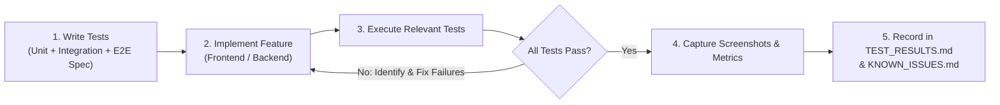

# Testing Strategy — Goodly Food Delivery Platform (`TESTING_STRATEGY.md`)

**Repository**: `https://github.com/MridulS11/MyFoodAntigravity.git`

## 1. Testing Philosophy & Mandatory Development Loop

Testing is an integral requirement of every development phase, not an afterthought. For **every single feature** across all phases, development must follow this strict loop:

### Non-Negotiable Rules
- **Never** disable, skip (`.skip`), or weaken existing assertions to obtain a passing build.
- **Never** fabricate test results, screenshots, performance metrics, or security claims.
- **Never** report a performance target as achieved until empirically measured via `k6`.
- **Never** use real payment credentials or charge real customer instruments during testing.
- **Always** verify actual PostgreSQL database rows and financial minor-unit balances during workflow tests, not just UI toast notifications.

---

## 2. Testing Infrastructure, Versions & Execution Commands

| Layer / Purpose | Tooling | Target Version | Installation Command | Execution Command |
| :--- | :--- | :--- | :--- | :--- |
| **Frontend Unit & Component Tests** | **Vitest** + React Testing Library + `@testing-library/user-event` | Vitest `^2.1.x` | `cd web && npm install -D vitest @vitejs/plugin-react jsdom @testing-library/react @testing-library/jest-dom @testing-library/user-event` | `cd web && npm run test:unit` (`vitest run --coverage`) |
| **Browser End-to-End (E2E) Tests** | **Playwright** (Chromium, Firefox, WebKit + Mobile Viewports) | Playwright `^1.48.x` | `cd web && npm install -D @playwright/test && npx playwright install --with-deps` | `cd web && npm run test:e2e` (`npx playwright test`) |
| **Backend Unit Tests** | **Go Native `testing`** + `stretchr/testify` | Go `1.22+` | Built-in (`go get github.com/stretchr/testify`) | `cd backend && go test -v -race ./internal/...` |
| **Backend & DB Integration Tests** | **Go `testing`** + `testcontainers-go` / Docker Compose (`PostGIS`, `Redis`, `RabbitMQ`) | `PostgreSQL 16 + PostGIS 3.4`, `Redis 7`, `RabbitMQ 3.13` | `docker compose -f docker-compose.test.yml up -d` | `cd backend && go test -v -race -tags=integration ./test/integration/...` |
| **API Contract & Interactive Inspection** | **OpenAPI 3.0** + **Swagger UI** + `@redocly/cli` | OpenAPI `3.0.3` | `npm install -D @redocly/cli` | `npx @redocly/cli lint backend/api/openapi/openapi.yaml` & `http://localhost:8080/swagger/index.html` |
| **Performance & Load Testing** | **Grafana k6** | k6 `^0.54.x` | `brew install k6` (macOS) or `docker run -i grafana/k6` | `k6 run test/load/checkout_spike.js --summary-export=artifacts/k6_summary.json` |
| **Dynamic Security Scanning (DAST)** | **OWASP ZAP** (Zed Attack Proxy) | `ghcr.io/zaproxy/zaproxy:stable` | `docker pull ghcr.io/zaproxy/zaproxy:stable` | `docker run --rm -t ghcr.io/zaproxy/zaproxy:stable zap-baseline.py -t http://host.docker.internal:3000 -r zap_report.html` |

---

## 3. Frontend Testing Scope (All Four Portals)

Every portal (**Customer**, **Restaurant**, **Delivery Partner**, **Administration**) is tested with both **Vitest** (component logic) and **Playwright** (browser automation):

1. **Navigation & Routing**: Direct deep links, breadcrumb transitions, back/forward browser history, and role-protected route redirects (e.g., unauthenticated user or `CUSTOMER` attempting to access `/admin/*` or `/restaurant/*` is redirected/blocked).
2. **Form Validation**: Client-side Zod validation for empty fields, malformed emails/phones, invalid coupon codes, out-of-bounds commission percentages, and customization group `min_selections` / `max_selections` rules.
3. **Responsive Layouts**: Automated Playwright viewport assertions at Desktop (`1440×900`), Tablet (`768×1024`), and Mobile (`390×844`).
4. **UI State Completeness**: Explicit tests forcing and verifying **Loading** (skeletons), **Empty** (empty bag, zero search results, empty KDS queue), **Error** (409 cart conflict, 500 server retry banner, network offline), and **Success** states.
5. **Browser Refresh & Session Persistence**: Reloading the page mid-flow (`page.reload()`) verifies that the customer's cart items, selected address, authenticated session, and active order tracking state persist accurately.
6. **UI-to-Backend Data Consistency**: Playwright tests intercept or query `/api/v1/*` directly and assert that displayed prices, taxes, order statuses, and settlement figures match the backend JSON payload to the cent/paisa.
7. **Screenshot Evidence Capture**:
   - Playwright is configured with `screenshot: 'on'` for key milestone pages and automatic full-page screenshot + trace capture on any test failure (`test-results/<test-id>/`).

---

## 4. Backend, Database & Integration Testing Scope

1. **Every API Endpoint (`Positive` & `Negative`)**:
   - Valid requests (`200`/`201`), malformed JSON/schema violations (`400`/`422`), unauthenticated (`401`), wrong role or cross-resource access (`403`), missing resource (`404`), state/idempotency conflict (`409`), and rate-limit exceeded (`429`).
2. **Database Constraints & Rollbacks**:
   - Explicitly test foreign key protections, `UNIQUE` constraints (`uq_orders_customer_idempotency`, `uq_payment_tx_provider_event`, `uq_delivery_accepted`), `CHECK (available_quantity >= 0)` constraints, and full transaction rollback when a mid-transaction step fails.
3. **Redis & Cache Invalidation**:
   - Verify cache miss $\rightarrow$ DB populate $\rightarrow$ cache hit, followed by immediate key eviction when a restaurant updates a dish price or toggles availability.
4. **RabbitMQ & Transactional Outbox**:
   - Verify `outbox_events` persistence, `OutboxRelay` publishing to `goodly.events`, consumer idempotency via `processed_messages`, exponential retry queue routing on transient error, and Dead-Letter Queue (`goodly.dlq`) routing after max retries.
5. **WebSocket Real-Time Communication**:
   - Verify ticket authentication, room authorization (`order:{id}`, `restaurant:{id}`, `partner:{id}`, `admin:live`), sub-second status broadcast, and sub-2-second GPS coordinate fanout.

---

## 5. Mandatory End-to-End Business Workflow Tests (10 Workflows)

Each of the following 10 workflows is automated end-to-end and asserts **both** UI behaviour and **authoritative PostgreSQL database state** (`orders`, `order_status_history`, `payments`, `refunds`, `menu_item_inventory`, `deliveries`, `restaurant_settlements`, `delivery_partner_earnings`):

1. **`WF-01` — Complete Happy-Path Order Lifecycle**: Customer checkout $\rightarrow$ payment capture $\rightarrow$ restaurant accepts $\rightarrow$ prepares $\rightarrow$ marks ready $\rightarrow$ delivery partner accepts offer $\rightarrow$ picks up $\rightarrow$ shares live GPS $\rightarrow$ confirms delivery with PIN $\rightarrow$ settlement & earnings records created.
2. **`WF-02` — Restaurant Order Rejection**: Customer pays $\rightarrow$ order `CONFIRMED` $\rightarrow$ restaurant rejects (`ITEM_OUT_OF_STOCK`) $\rightarrow$ order transitions to `CANCELLED` $\rightarrow$ full refund automatically queued and processed $\rightarrow$ customer notified.
3. **`WF-03` — Payment Failure & Retry**: Customer initiates checkout $\rightarrow$ gateway returns payment failure $\rightarrow$ order remains `PENDING_PAYMENT` (`payment_status = 'FAILED'`) $\rightarrow$ customer retries payment with new session $\rightarrow$ payment succeeds $\rightarrow$ order transitions to `CONFIRMED` without duplicating order items or double-reserving stock.
4. **`WF-04` — Delivery Assignment Failure & Escalation**: Restaurant accepts order $\rightarrow$ Partner 1 rejects offer $\rightarrow$ Partner 2 lets 45s timer expire $\rightarrow$ no other partners online $\rightarrow$ delivery transitions to `UNASSIGNABLE` $\rightarrow$ order appears in Admin Live Ops Attention Queue for manual assignment.
5. **`WF-05` — Concurrent Orders for Limited Inventory**: Dish `Burrata & tomatoes` has `available_quantity = 1`. Two customers submit `POST /api/v1/orders` simultaneously via `sync.WaitGroup`. Exactly one commits (`201 Created`, `available_quantity = 0`, `is_available = FALSE`) and the other receives `409 ITEM_OUT_OF_STOCK`.
6. **`WF-06` — Order Cancellation & Refund**: Customer cancels an eligible paid order $\rightarrow$ row lock serializes state transition to `CANCELLED` $\rightarrow$ reserved inventory restored $\rightarrow$ refund record created and reconciled.
7. **`WF-07` — Duplicate Order Submission**: Client sends 5 concurrent `POST /api/v1/orders` requests with the same `Idempotency-Key`. Only 1 order row is created in PostgreSQL; all responses return the same `order_id`.
8. **`WF-08` — Duplicate Payment Callbacks**: Gateway sends the same `payment.captured` webhook 5 times concurrently alongside the frontend `/verify` call. Only 1 `payment_transactions` row and 1 `order.confirmed` outbox event are created.
9. **`WF-09` — Duplicate Delivery Assignment Attempts**: 5 delivery partners concurrently call `/accept` on the same delivery offer. Only 1 partner wins the atomic lock; the other 4 receive `409 OFFER_ALREADY_TAKEN`.
10. **`WF-10` — Server Restart & Recovery**: Simulate worker/API restart with uncommitted transactions, pending `outbox_events`, unacknowledged RabbitMQ messages, and expiring `delivery_assignments`. Verify clean recovery with zero lost events or corrupted records.

---

## 6. Performance & Load Testing Strategy (`k6`)

Using **Grafana k6**, we execute staged ramp-up workloads (`50` $\rightarrow$ `250` $\rightarrow$ `500` $\rightarrow$ `1,000+` concurrent VUs) and capture:
- **Latency Percentiles**: `p50`, `p95`, and `p99` response times per endpoint group.
- **Throughput & Reliability**: Requests per second (RPS) and HTTP error rate (`%`).
- **Infrastructure Telemetry (via Prometheus + Docker stats / CloudWatch)**:
  - Go process CPU (`%`), RSS memory, and goroutine count.
  - PostgreSQL active/idle connection pool utilization (`pg_stat_activity`) and slow query logs.
  - Redis command latency, memory usage, and cache hit/miss ratio.
  - RabbitMQ queue depth and publish-to-consume processing delay (`ms`).

Every performance run records its exact hardware/container specs, dataset size, `k6` script parameters, raw output metrics, identified bottlenecks, and `EXPLAIN ANALYZE` optimizations in `TEST_RESULTS.md`.

---

## 7. Security Testing Strategy (OWASP ZAP + Automated Security Suite)

1. **Automated OWASP ZAP Scanning**:
   - Run `zap-baseline.py` against all 4 Next.js web portals and `zap-api-scan.py` against `/api/v1/openapi.yaml` to detect missing security headers (`CSP`, `HSTS`, `X-Content-Type-Options`), cookie flags (`HttpOnly`, `Secure`, `SameSite`), CORS misconfigurations, and injection vectors.
2. **Authorization & IDOR (Cross-User Data Exposure) Suite**:
   - Automated tests attempting to read/modify Customer B's order/address using Customer A's JWT, Restaurant B's menu using Restaurant A's JWT, Partner B's earnings using Partner A's JWT, and Admin endpoints using non-privileged admin roles.
3. **Injection, XSS & CSRF**:
   - SQL injection payloads against search (`?q=`), filter, and sort parameters; stored/reflected XSS payloads in dish descriptions, review comments, and delivery instructions; CSRF validation on cookie-authenticated endpoints.
4. **Rate Limiting & Webhook Forgery**:
   - Automated burst tests verifying `429 Too Many Requests` on `/auth/login` and `/auth/otp/send`; forged HMAC signature rejection (`401`) on `/payments/webhooks/:provider`.

---

## 8. Reproducible Test Data Management & Safe Reset Process

A dedicated CLI command (`cmd/seed/main.go`, invoked via `make db-seed` or `make db-reset-test`) manages deterministic seed datasets:

### Seeded Entities
- **Customers**: 5 test customers (`alice@goodly.local`, `bob@goodly.local`, etc.) with verified phones and saved PostGIS addresses in Brooklyn, NY (and secondary test zone).
- **Restaurants & Menus**:
  - `Sunday Table` (Neighborhood Italian, Est. 2018 — `Sunday rigatoni $18.00`, `Burrata & tomatoes $16.00`, `Sunday table salad $14.00`, `Chicken cutlet sandwich $17.00`, plus customized dishes and a limited-stock dish with `available_quantity = 2`).
  - `Little Green Bowl` (Healthy · Bowls · Fresh) & `Good Bird` (Burgers · Fried chicken · Sides), plus 1 `PENDING_REVIEW` restaurant for Admin KYC testing.
- **Delivery Partners**: 4 partners (`ONLINE_AVAILABLE` at known coordinates around Brooklyn, `ON_DELIVERY`, `OFFLINE`, and `PENDING_REVIEW`).
- **Administrators**: 4 admin accounts (`superadmin@goodly.local`, `opsadmin@goodly.local`, `financeadmin@goodly.local`, `supportadmin@goodly.local`).
- **Orders, Payments & Refunds**: Pre-seeded historical and active orders across `PENDING_PAYMENT`, `CONFIRMED`, `PREPARING`, `READY_FOR_PICKUP`, `OUT_FOR_DELIVERY`, `DELIVERED`, `CANCELLED`, and `REFUNDED` states.

### Production Safety Guard
The database reset utility enforces a three-way hard abort before executing any `TRUNCATE` or `DROP`:
1. Checks `APP_ENV` (`MUST` be `development` or `test`; panics immediately if `production` or `staging`).
2. Checks the PostgreSQL host (`MUST` be `localhost`, `127.0.0.1`, or Docker internal `postgres-test`).
3. Checks a database metadata table `platform_configs` where `allow_test_reset = true` must be explicitly present.

---

## 9. GitHub Actions CI/CD Pipeline (`https://github.com/MridulS11/MyFoodAntigravity.git`)

### 9.1 Per-Push / Pull Request Pipeline (`.github/workflows/ci.yml`)
Triggered on every `push` and `pull_request` to `main`:
1. **Lint & Format**: `golangci-lint` + `gofmt` (backend) and `eslint` + `tsc --noEmit` (frontend).
2. **API Contract Validation**: `@redocly/cli lint backend/api/openapi/openapi.yaml`.
3. **Frontend Build & Unit Tests**: `npm run build` + `npm run test:unit` (Vitest).
4. **Backend Unit Tests**: `go test -v -race ./internal/...`.
5. **Backend Integration & Workflow Tests**: Spins up service containers (`postgis/postgis:16-3.4`, `redis:7-alpine`, `rabbitmq:3.13-alpine`), runs migrations, seeds test data, and executes `go test -v -race -tags=integration ./test/...` (covering all 10 mandatory business workflows).
6. **Critical Playwright E2E Suite**: Starts backend + Next.js app, runs Playwright across all 4 portals, and uploads HTML report + screenshots as GitHub Actions artifacts.

### 9.2 Milestone Load & Security Pipeline (`.github/workflows/milestone-verify.yml`)
Triggered on phase completion tags (`phase-*`) or `workflow_dispatch`:
1. **k6 Performance Suite**: Runs progressive load tests and uploads latency/RPS telemetry reports.
2. **OWASP ZAP Baseline & API Scan**: Runs ZAP against the web portals and OpenAPI spec, failing on any High/Medium risk alerts.

---

## 10. Mandatory Testing Reports & Phase Completion Gate Rules

Four living testing documents are maintained in the repository root and updated at every phase:
1. [`TESTING_STRATEGY.md`](file:///Users/m/.gemini/antigravity/brain/f69482ad-91cd-48c8-aad4-55af6ea4bc0f/TESTING_STRATEGY.md) — Testing architecture, commands, and governance.
2. [`TEST_CASES.md`](file:///Users/m/.gemini/antigravity/brain/f69482ad-91cd-48c8-aad4-55af6ea4bc0f/TEST_CASES.md) — Master catalog of all test cases (`TC-FE-*`, `TC-BE-*`, `TC-WF-*`, `TC-PERF-*`, `TC-SEC-*`).
3. [`TEST_RESULTS.md`](file:///Users/m/.gemini/antigravity/brain/f69482ad-91cd-48c8-aad4-55af6ea4bc0f/TEST_RESULTS.md) — Empirical phase-by-phase test execution ledger (Feature, Test Case ID, Expected, Actual, Status: `PASSED` / `FAILED` / `SKIPPED` / `NOT_YET_IMPLEMENTED`, Evidence/Screenshot path, Bugs discovered, Fixes applied).
4. [`KNOWN_ISSUES.md`](file:///Users/m/.gemini/antigravity/brain/f69482ad-91cd-48c8-aad4-55af6ea4bc0f/KNOWN_ISSUES.md) — Defect tracker, severity classification, root cause, and resolution status.

### Phase Submission Gate Checklist
A phase will **only** be submitted for project owner approval when:
- [ ] All required features for the phase are implemented.
- [ ] All unit, integration, and Playwright browser tests for the phase pass (`0` failing tests).
- [ ] Zero unresolved Critical or High-severity defects exist in `KNOWN_ISSUES.md`.
- [ ] `TEST_RESULTS.md` is updated with actual execution logs and screenshot evidence.
